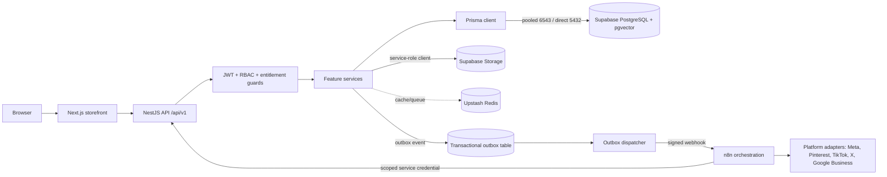

# ATVOO Developer Handbook (v4 — Build-Ready Edition)

**Project:** ATVOO ("AI-Based Most Modern Shopping Store")
**Repository:** `imtiaz_mart`
**Audience:** Developers, technical leads, QA engineers, DevOps engineers, and AI coding agents (including Cursor)
**Document status:** Source of truth for architecture, infrastructure, process, and UI/UX implementation
**Supersedes:** v3 (Supabase + n8n edition); all prior versions are historical only
**Last verified:** 2026-09-22

This is the primary onboarding and operating guide for the ATVOO monorepo. It explains how the system is organized, how to run it, how to change it safely, and how to deploy it. The numbered specification documents in `docs/` remain the domain specifications — they describe product intent and target architecture. This handbook records the relationship between those requirements and the code, and is the operational source of truth for infrastructure, environment, and process.

## Cursor / AI-agent operating rule (binding)

Per `05_DEVELOPMENT_STANDARDS.md`, before generating code for any feature, read this handbook **and**:

```text
01_PROJECT_MASTER_SPECIFICATION.md
02_DATABASE_ARCHITECTURE.md
03_UI_UX_DESIGN_SYSTEM.md
04_API_ARCHITECTURE.md
05_DEVELOPMENT_STANDARDS.md
06_SOCIAL_MEDIA_AUTOMATION_ENGINE.md
07_AI_AGENT_COMMERCE_READINESS.md
```

**Never make an architectural assumption that conflicts with the specifications.** Where this handbook summarizes a specification for operational convenience (most heavily in §9.6 and §9.8, which summarize `07` and `06` respectively), the numbered specification is authoritative for the details; this handbook is authoritative for how that detail maps onto infrastructure, commands, and environments. If the two genuinely disagree, stop and record the discrepancy (§ Source-of-truth hierarchy) rather than picking one silently. Generate production-ready, enterprise-grade code only — no placeholder logic presented as complete.

## 0. What changed in this revision (read this first)

v2 adapted the project to Supabase without having seen the numbered specifications. Having now read all seven, three corrections matter enough to call out before anything else:

1. **Social automation is not a minor opt-in feature — it is a full event-driven subsystem** with its own orchestration engine (n8n), transactional outbox, capability registry, approval state machine, and dead-letter handling. §9.8 and §2 now reflect this; treat `06_SOCIAL_MEDIA_AUTOMATION_ENGINE.md` as required reading before touching any social/marketing module, not as background context.
2. **RBAC permissions and subscription entitlements are two different authorization axes.** A vendor user can have the `social:write` permission and still be blocked by the `social.automation.enabled` entitlement if their plan doesn't include it. Previous revisions of this handbook only modeled permissions. See §1.2.
3. **AI Agent Commerce (UCP/ACP/Perplexity) is a named, dated, protocol-specific integration**, not a vague future capability. §9.6 is rewritten around the actual protocols and a recommended low-risk MCP pilot.

Everything from v2 regarding Supabase as the managed Postgres provider, RLS default-deny, Supabase Storage for uploads, and the canonical deployment paths remains in force and is **independently corroborated** by `SETUP_DATABASE.md` and `06_SOCIAL_MEDIA_AUTOMATION_ENGINE.md` (both explicitly name Supabase PostgreSQL as the database). Those sections are carried forward with minor corrections (UUID v7, not generic UUID; n8n added to the architecture diagram).

v4 closes out every remaining item that would otherwise require a clarifying question mid-build: the three cross-document faults surfaced by reading all specs together (§0.3), and a complete, opinionated UI/UX implementation system (§7) so screens don't stall on undefined tokens, states, or breakpoints. See §0.4 for the standing confirmation that this document is build-ready.

### 0.3 Cross-document faults, resolved here

Reading `01`–`07` together surfaced three places where the specifications disagree with each other or leave a gap this handbook must close before Cursor can build without stopping to ask. Each is resolved as **binding** below; the underlying spec files are unedited, so treat this section as the authoritative reconciliation per the source-of-truth hierarchy's instruction to "record the discrepancy" rather than pick a side silently.

**Fault 1 — `02_DATABASE_ARCHITECTURE.md`'s social-automation table list is stale.** `06_SOCIAL_MEDIA_AUTOMATION_ENGINE.md` §27 states explicitly that `02`'s original list (`VendorSocialAccounts, SocialAutomationRules, SocialPostQueue, SocialPostTemplates...`) "is not sufficient for the target system" and supplies a replacement. `02` was never updated to match. **Binding resolution: §8.1.1 of this handbook is the authoritative social-automation schema. Do not implement `02`'s original social-automation list.** If anyone edits `02_DATABASE_ARCHITECTURE.md` directly, replace its Social Media Automation Module section with §8.1.1's list or a pointer to it, so the two documents stop disagreeing.

**Fault 2 — the "single Order, vendor sub-orders underneath" model was only ever prose.** `01`'s market-weakness table promises this as a named differentiator; `02`'s Order Management entities (`Orders, OrderItems, OrderStatusHistory, Shipments, Returns, Refunds, Invoices`) never say how a sub-order is actually represented. **Binding resolution:** a vendor sub-order is **not** a separate top-level entity. It is the set of `OrderItems` on a single `Order` sharing the same `vendorId`, each vendor's subset gets exactly one `Shipment` (so `Shipments.vendorId` is a required, indexed column), and `OrderStatusHistory` is recorded per `Shipment` for vendor-controllable states (packed, shipped, delivered) and per `Order` for buyer-facing states (placed, paid, cancelled, completed). The customer-facing API and UI always aggregate up to the single `Order`; a vendor-facing API/UI filters down to that vendor's `Shipment` and its `OrderItems`. Do not create an `OrderSubOrder` or `VendorOrder` table — this would duplicate data `OrderItems.vendorId` and `Shipments.vendorId` already express.

**Fault 3 — `04_API_ARCHITECTURE.md` has no endpoints for the escrow/payout flow this handbook defines in §0.2.** That flow didn't exist when `04` was written. **Binding resolution — the following endpoints are added to the Admin API group (§6.3) and must be implemented alongside the escrow schema, not deferred:**

```text
GET   /admin/payouts/escrow                 list EscrowHoldings, filterable by status/vendor/date
POST  /admin/payouts/escrow/:id/release     manual release (support-resolved dispute, no-shipment digital goods)
POST  /admin/payouts/escrow/:id/reverse     manual reversal (refund/chargeback before scheduled release)
GET   /admin/payouts/batches                list VendorPayout batch runs
POST  /admin/payouts/batches/run            trigger a payout batch (gated behind the finance/legal sign-off flag, §0.2)
GET   /vendor/payouts/escrow                vendor-scoped read-only view of their own held/released escrow
```

**Also resolved, not deferred:** `SETUP_DATABASE.md` is **superseded by this handbook (§3–§4) and retired**. Its content is fully absorbed here; do not maintain it as a second source of Supabase setup instructions. Delete it from the repository, or if it must remain for a transitional period, replace its body with a single line pointing to this handbook and remove its row from `README.md`'s document table.

### 0.4 Definition of ready (standing confirmation)

This handbook is build-ready: every technical decision has a resolved default (§0.1), the payout/escrow flow is schema- and API-complete pending only a finance/legal flag (§0.2), the three cross-document contradictions are reconciled (§0.3), and the UI/UX system in §7 specifies tokens, states, breakpoints, and component behavior completely enough that no screen should require an undocumented judgment call. If Cursor (or a developer) hits a genuine ambiguity this document doesn't cover, that is itself a defect in this handbook — fix the handbook in the same PR as the code, per §15, rather than resolving it silently in one place only.

## How to use this handbook

Read the sections in order when joining the project. For a feature change, start with the relevant domain specification, inspect the owning module and schema, then follow the change checklist in §15.

Status labels used throughout:

| Label | Meaning |
| --- | --- |
| **Implemented** | Present in the repository and usable in the documented environment. |
| **Partial** | Some code exists, but important production behavior or integration work remains. |
| **Planned** | Described by the specifications but not yet implemented or not verified in code. |
| **Prerequisite** | Requires external infrastructure, credentials, provider approval, or an operational decision. |
| **Needs confirmation** | Documentation and implementation disagree or the behavior requires an explicit product decision. |
| **Open decision** | Requires a business/legal/finance call this handbook cannot make on its own. See §0.1. |

### 0.1 Decisions (resolved defaults, and what still needs real sign-off)

Four of the five decisions this handbook previously left open have a defensible default and are resolved below so Cursor isn't blocked. One is a genuine financial/legal commitment that a document cannot make — it gets a concrete recommended model instead, explicitly gated on sign-off before it is enabled with real money.

| Decision | Resolution | Status |
| --- | --- | --- |
| n8n hosting | **n8n Cloud** for MVP — faster to start, provider handles patching/upgrades, avoids a second piece of infrastructure to operate before automation volume justifies it. Self-host (Docker, alongside the API host) remains a documented fallback if cost or data-residency requirements change later; the workflow-export discipline in §2/§9.8.3 makes that migration mechanical, not a rewrite. | **Resolved (default)** — revisit if per-execution cost or data residency becomes a constraint |
| Transactional email provider | **Resend.** Chosen for a straightforward API, good deliverability reputation, and a template model that fits password reset, order confirmation, and vendor approval emails without extra infrastructure. Implemented behind a thin provider interface (`apps/api/src/modules/notifications/email/`) so swapping providers later is a one-file change, not a rewrite. | **Resolved (default)** |
| Kubernetes vs. single-container host | **Single-container host now** (Railway/Render/Fly.io per §13.2), Dockerfile kept Kubernetes-compatible. Revisit when a concrete scale trigger is hit — sustained load that a single instance/host's autoscaling can't absorb, a multi-region requirement, or a compliance requirement for isolated node pools. Provisioning a cluster before any of those exist adds operational cost with no corresponding benefit. | **Resolved (default)** |
| Escrow / merchant-of-record model for vendor payouts | See §0.2 below — a concrete default flow is specified so the data model and API can be built now, but **enabling real payouts against it requires finance/legal sign-off**, not just engineering completion. | **Recommended default — sign-off required before production payouts** |
| Agentic checkout payment rail ownership (ATVOO vs. vendor as merchant of record) | Follows directly from the escrow decision above — whoever is merchant of record for normal checkout is merchant of record for agentic checkout too, since ACP/UCP settlement rides on the same payout model. No separate decision needed once §0.2 is signed off. | **Tied to §0.2 — no independent action required** |

### 0.2 Recommended escrow / payout model (build-ready default, pending finance/legal sign-off)

This is an engineering-usable default, not a legal opinion — a payments lawyer or licensed financial partner should confirm it against ATVOO's actual jurisdiction, payment processor agreements, and money-transmission obligations before it goes live with real funds. It exists so `Payments`, `Transactions`, `VendorPayouts`, and `EscrowHoldings` (§8.1) have a concrete flow to implement against instead of sitting as an undefined data model.

**Model: ATVOO as merchant of record, holding funds in escrow until a release trigger fires.**

```text
1. Customer pays at checkout → payment captured by ATVOO's payment processor (Stripe/JazzCash/Easypaisa).
2. Full captured amount recorded as an EscrowHoldings row per vendor sub-order, status HELD.
3. Release trigger (whichever fires first, configurable per product category):
     - delivery confirmed (from ShipmentTracking) + return window elapsed (default 7 days,
       vendor/category override allowed), OR
     - platform admin manual release (support-resolved dispute, digital goods with no
       shipment, etc.)
4. On release: EscrowHoldings status -> RELEASED, platform commission (PLATFORM_FEE_RATE)
   deducted, remainder credited to the vendor's pending payout balance.
5. VendorPayouts are batched on a fixed schedule (default: weekly) rather than released
   per-order, to keep payout volume auditable and reconcilable.
6. A refund or dispute before release reverses the EscrowHoldings row (status -> REVERSED)
   without ever reaching VendorPayouts. A refund or chargeback after release creates a
   negative adjustment against the vendor's next payout batch, never a silent balance edit.
```

This same flow is what agentic checkout (§9.6.3) settles against — an ACP/UCP order captures payment the same way a normal checkout does, so no separate payment-rail decision is needed once this model is approved.

**What still requires explicit sign-off before this is enabled for real transactions:** the escrow hold period per category, whether ATVOO's payment processor agreements actually support holding funds this way (some processors have their own hold/release mechanics that should be used instead of a parallel one), and the money-transmission/regulatory implications of ATVOO holding funds at all in its operating jurisdiction(s). Build the schema and API now; gate the production release-of-funds cron/job behind a feature flag that only finance/legal turns on.

## Source-of-truth hierarchy

When sources disagree, use this order and document the discrepancy rather than silently guessing:

1. **Runtime configuration and source code** define current application behavior.
2. **`packages/database/prisma/schema.prisma`, migrations, and the live Supabase project schema** define persisted data behavior. If the deployed Supabase schema and the migration history disagree, treat this as an incident (§14), not a documentation problem.
3. **This handbook** defines supported developer and operational procedures, and reconciles the specifications with the Supabase/n8n infrastructure decision.
4. **The numbered specifications** (`01`–`07`) define intended product, data, and integration architecture. They outrank this handbook on domain modeling, API surface, design tokens, and the SMAE/AI-agent-commerce target architecture — this handbook must be updated to match them, not the reverse.
5. **Issue and roadmap material** defines future work only.

Never describe a planned feature as production-ready merely because its name appears in a specification or schema design list.

## Contents

1. [Project orientation](#1-project-orientation)
2. [Repository layout](#2-repository-layout)
3. [Prerequisites and local setup](#3-prerequisites-and-local-setup)
4. [Configuration and environment](#4-configuration-and-environment)
5. [System architecture](#5-system-architecture)
6. [Backend development](#6-backend-development)
7. [Frontend development, UI, and UX](#7-frontend-development-ui-and-ux-complete-build-system)
8. [Database development (Supabase)](#8-database-development-supabase)
9. [Business workflows](#9-business-workflows)
10. [Feature status](#10-feature-status)
11. [Security and compliance](#11-security-and-compliance)
12. [Testing and quality](#12-testing-and-quality)
13. [Deployment and operations](#13-deployment-and-operations)
14. [Troubleshooting](#14-troubleshooting)
15. [Change checklists](#15-change-checklists)
16. [Reference](#16-reference)

---

## 1. Project orientation

ATVOO is a multi-vendor marketplace built to compete with Amazon, Etsy, Shopify Plus Marketplaces, Alibaba, Daraz, Noon, and Temu (`01_PROJECT_MASTER_SPECIFICATION.md` §1). It supports B2C commerce, multi-vendor marketplace operations, social commerce, mobile commerce, AI commerce, AI-agent commerce, visual-search commerce, and a future B2B expansion.

### 1.0 Platform modules

```text
Public Website · Customer Portal · Vendor Portal · Admin Portal
CMS · Marketing Automation · Social Media Automation Engine (vendor premium add-on)
AI Agent Commerce Layer · Visual Search Engine · Loyalty System · Affiliate System
Inventory Management · Finance Management · Search Engine · AI Recommendation Engine
Analytics System · Notification System · API Gateway · Mobile Applications
```

Every module above must be traceable to a section of this handbook or an owning spec before it is considered in scope for a given release — see the feature-status matrix (§10).

### 1.0.1 Non-functional requirement targets

These are binding acceptance criteria, not aspirations. A feature is not "done" if it silently regresses one of these:

| Requirement | Target |
| --- | --- |
| Availability | 99.9% |
| Page load time | < 2 seconds |
| Desktop PageSpeed score | > 95 |
| Mobile PageSpeed score | > 90 |
| Accessibility | WCAG 2.1 AA |
| Visual search response time (upload → embed → vector search → render) | < 2 seconds end-to-end |
| Architecture | Cloud-ready, disaster-recovery-ready, horizontally scalable |

### 1.0.2 Market weaknesses this architecture exists to close

`01_PROJECT_MASTER_SPECIFICATION.md` §13 names the specific competitor failure modes this platform is designed against — treat these as design constraints, not marketing copy, because they directly justify several "binding" rules elsewhere in this handbook:

- **Payment splitting / commission leakage** → commission math and payout holds are system-of-record (`Payments`, `Transactions`, `VendorPayouts`, `EscrowHoldings`), never manual reconciliation. See the open escrow decision in §0.1.
- **Fragmented multi-vendor orders** → the buyer sees **one Order**; vendor sub-orders and `Shipments` are generated underneath it, split invisibly on the backend. Do not design an API or UI that exposes per-vendor order fragmentation to the customer.
- **Inconsistent vendor policies** → shipping/return/refund policies are platform-level templates vendors inherit by default, with only bounded, disclosed deviations.
- **Weak search at scale** → PostgreSQL full-text search plus `pgvector` semantic/visual search, not keyword `LIKE` queries (§9.2, §9.7).
- **Not API-first** → REST API with versioning and Swagger/OpenAPI, and the AI Agent Commerce Layer (§9.6) is treated as just another channel of the same API-first design, not a bolt-on.
- **Cold-start problem** → not solvable by architecture alone; requires a launch strategy (curated vendor cohort, Store Channel social automation from day one — see Mode B in §9.8).

### 1.1 Core principles

- Treat catalog and inventory data as canonical commerce data.
- Enforce authorization in the API; frontend checks are only for user experience.
- Enforce a second, independent layer of authorization at the database via RLS default-deny policies (§8.6), even though the API's own connection bypasses RLS. This protects against misconfiguration, not against the API itself.
- Prefer server components and server-side data access for public Next.js pages.
- Keep database changes migration-driven and reversible where practical, and keep the Supabase project's live schema and the committed migration history identical at all times.
- Make external integrations opt-in, observable, rate-limited, and independently disableable.
- Preserve vendor isolation: a vendor must only access resources owned by or assigned to that vendor. This applies with equal force to n8n workflows acting on a vendor's behalf (§9.8).
- Keep customer, payment, OAuth, and operational secrets out of logs and source control. Treat the Supabase **service role key** and any **n8n service credential** with the same severity as a database superuser password.
- AI-generated output — captions, hashtags, recommendations, summaries — is untrusted until validated against authoritative ATVOO data. This applies everywhere AI touches the platform (social captions, AI search, review summaries), not only in the social automation engine where the specification states it explicitly.

### 1.2 User roles, permissions, and entitlements

Three distinct concepts govern what an operation is allowed to do. Conflating them is the single most common authorization bug in a marketplace codebase — keep them separate in code as well as in this table.

| Concept | Answers | Checked by | Example |
| --- | --- | --- | --- |
| **Role** | Who is this user, broadly? | Assignment at signup/invite time | Vendor owner |
| **Permission** | Is this user allowed to perform this operation at all? | RBAC guard against the `Permission` enum (§1.2.1) | `social:write` |
| **Entitlement** | Does this vendor's subscription plan include this capability right now? | Entitlement guard against the vendor's active subscription (§1.2.2) | `social.automation.enabled` |

The authorization chain for any vendor-scoped mutation, per `06_SOCIAL_MEDIA_AUTOMATION_ENGINE.md` §7 (and applied project-wide, not only to social automation):

```text
Authenticated user
→ vendor membership
→ vendor permission (RBAC)
→ subscription entitlement
→ resource ownership (social account, rule, order, product, etc.)
→ requested operation
```

Changing an ID in a request must never allow cross-vendor access, at any step in this chain.

| Role | Responsibility |
| --- | --- |
| Guest | Browse public content and maintain a guest cart using a session header. |
| Customer | Purchase products, manage account data, orders, reviews, returns, and rewards. |
| Vendor owner | Manage a vendor store, catalog, inventory, orders, staff, and eligible marketing features. |
| Vendor staff | Perform assigned vendor operations without owner-level access. |
| Affiliate | Refer traffic and receive eligible commissions. |
| Support agent | Handle customer and order support within assigned permissions. |
| Inventory manager | Manage stock, warehouses, reservations, and inventory operations. |
| Marketing manager | Manage CMS, campaigns, store social channels, and merchandising. |
| Finance manager | Manage payments, refunds, payouts, commissions, and financial reporting. |
| Admin | Manage platform operations within assigned RBAC permissions. |
| Super admin | Full platform administration and emergency controls. |

Seed data (`db:seed`) must create these roles under stable slugs (`customer`, `vendor_owner`, `vendor_staff`, `affiliate`, `support_agent`, `inventory_manager`, `marketing_manager`, `finance_manager`, `admin`, `super_admin`) per `SETUP_DATABASE.md`, each mapped to a fixed permission set.

#### 1.2.1 Permission model (binding — implement exactly this)

```text
catalog:read        catalog:write        catalog:approve
inventory:read       inventory:write
orders:read           orders:write         orders:refund
payouts:read          payouts:write
vendor:staff:manage
customers:read        customers:write
cms:read               cms:write
settings:write
social:read             social:write        social:publish
reports:read
admin:emergency
```

Each role in §1.2 maps to a fixed, seed-defined set of these permissions. A guard checks the permission, never the role literal, except where a route is explicitly `Super admin`-only (`admin:emergency`). Extend, never rename, once shipped.

#### 1.2.2 Entitlement model (binding — separate from permissions)

Per `06_SOCIAL_MEDIA_AUTOMATION_ENGINE.md` §6: **do not hard-code business behavior around tier names.** Check dot-namespaced entitlement keys, resolved server-side from the vendor's active subscription. The API decides entitlement — never the frontend, never n8n.

```text
social.manual_publish
social.connected_accounts.max
social.automation.enabled
social.ai_generation
social.approval_workflow
social.best_time
social.analytics
social.ab_testing
social.custom_cadence
```

Suggested commercial mapping (Starter → manual share only; Growth → scheduled posting, limited destinations, standard AI generation; Premium → multi-platform automation, event triggers, AI content/asset selection, best-time, advanced analytics; Enterprise → Premium + A/B variants, custom cadence/governance, advanced isolation). Treat plan names as a seed/pricing-table concern that maps onto entitlement keys — never branch application logic on the plan name string itself.

### 1.3 Revenue model and scope

Commissions, vendor subscriptions, sponsored placement, advertising, affiliate commissions, gift cards, memberships, and the Social Media Automation add-on (tiered, per vendor) are the named revenue streams. Each stream must be checked against the feature-status table (§10) before implementation or release planning.

---

## 2. Repository layout

```text
imtiaz_mart/
├── apps/
│   ├── web/                    Next.js storefront and portals
│   └── api/                    NestJS REST API
├── packages/
│   ├── database/               Prisma schema, migrations, client package
│   └── shared/                 Shared TypeScript types and constants
├── supabase/
│   ├── config.toml              Supabase CLI project config (linked project)
│   └── migrations/              RLS policies, extensions, storage buckets — kept in lockstep with Prisma migrations (§8.2)
├── workflows/
│   └── n8n/                     Exported, version-controlled n8n workflow JSON (WF-01..WF-10, §9.8.3) — the versioned artifact referenced by SocialWorkflowRuns.workflow_version
├── docs/                       Specifications and developer documentation (01–07, this handbook, README, SETUP_DATABASE)
├── .github/
│   └── workflows/               CI: lint, build, test, migrate-deploy, deploy
├── docker-compose.local.yml    OPTIONAL: local Redis + local Postgres for fully offline development only
├── package.json                Root workspace scripts and lifecycle hooks
├── package-lock.json           Canonical npm lockfile
├── vercel.json                 Storefront deployment configuration
└── .env.example                Environment variable template
```

### 2.1 Workspace responsibilities

**`apps/web`** owns the browser-facing experience: Next.js App Router, route groups, server components by default, client components where interaction requires them, shared API/action helpers under `lib/`.

**`apps/api`** owns authentication, authorization, catalog, commerce, administration, integrations, and public machine-readable endpoints. Its global prefix is `/api`; URI versioning adds `/v1`. Per `05_DEVELOPMENT_STANDARDS.md`, each feature module follows **Clean Architecture / DDD boundaries within the Nest module structure**: controllers are transport-only, services hold domain/business rules, and a repository-pattern boundary sits between services and Prisma — see §6.1.

**`packages/database`** owns the Prisma schema, migration history, generated Prisma client access, and seed scripts.

**`packages/shared`** owns types and constants shared by web and API, including the `Permission` and entitlement-key enums (§1.2.1, §1.2.2). Keep it free of server-only dependencies and browser-only dependencies.

**`supabase/`** owns the link between this repository and the hosted Supabase project(s), plus RLS policy SQL and storage bucket definitions that Prisma does not model directly.

**`workflows/n8n/`** owns the exported JSON of every production n8n workflow, so that "if n8n is deleted, recreated, or replaced, business state must remain intact" (`06` §35) is actually achievable — a workflow that exists only inside the n8n UI with no exported artifact in version control is not considered production-ready.

### 2.2 Dependency direction

```text
web  ───────────────┐
                    ├── shared
api  ── database ───┘
n8n  ── api (HTTP, scoped service credential) ── database
```

n8n never connects to the database directly for business mutations (§9.8.2). The database package must not import application modules. Shared types must not import Prisma, NestJS, Next.js, or runtime secrets.

### 2.3 Important source locations

| Concern | Location |
| --- | --- |
| API module composition | `apps/api/src/app.module.ts` |
| API bootstrap, versioning, CORS, Swagger | `apps/api/src/main.ts` |
| API feature modules | `apps/api/src/modules/` |
| API guards and filters | `apps/api/src/common/` |
| Permission enum and role→permission map | `packages/shared/src/rbac.ts` |
| Entitlement key enum and plan→entitlement map | `packages/shared/src/entitlements.ts` |
| Web routes | `apps/web/app/` |
| Web reusable UI | `apps/web/components/` |
| Web API/action helpers | `apps/web/lib/` |
| Design tokens | `apps/web/lib/design-tokens.ts` (must match §3 of `03_UI_UX_DESIGN_SYSTEM.md` — see §7.2) |
| Shared exports | `packages/shared/src/index.ts` |
| Database schema | `packages/database/prisma/schema.prisma` |
| Database seeds | `packages/database/prisma/seed*.ts` |
| RLS policy SQL | `supabase/migrations/` |
| n8n workflow exports | `workflows/n8n/` |
| Optional offline local services | `docker-compose.local.yml` |
| Deployment config | `vercel.json`, `apps/api/Dockerfile`, `.github/workflows/` |

---

## 3. Prerequisites and local setup

### 3.1 Required tools

- Node.js 20 LTS or newer, pinned via `.nvmrc`.
- npm with workspace support.
- The [Supabase CLI](https://supabase.com/docs/guides/cli).
- Git.
- A Supabase account with a **development** project dedicated to this purpose — never develop against the production project.
- An n8n instance for local workflow development: either a personal n8n Cloud workspace, or `npx n8n` / Docker locally. Not required for pure API/frontend work that doesn't touch social automation.
- Docker Engine — only required for the fully offline fallback (`docker-compose.local.yml`) or local n8n.

### 3.2 First-time setup (standard path)

1. Create a Supabase development project. Enable `pgvector` and `pg_trgm` under **Database → Extensions**.
2. Copy the **Transaction pooler** string (port `6543`) for `DATABASE_URL` and the **Session pooler**/**Direct connection** string (port `5432`) for `DIRECT_URL` from **Project Settings → Database**.
3. Copy the project URL, `anon` key, and `service_role` key from **Project Settings → API**.
4. Create the Storage buckets listed in §9.9 if not already present (or run the bootstrap script in step 6, which is idempotent).

```bash
cp .env.example .env
# fill in DATABASE_URL, DIRECT_URL, SUPABASE_URL, SUPABASE_ANON_KEY,
# SUPABASE_SERVICE_ROLE_KEY from the values above
npm ci
supabase link --project-ref <your-dev-project-ref>
npm run db:migrate:deploy
npm run db:bootstrap:supabase   # creates storage buckets, applies RLS policies — §8.6/§9.9
npm run db:seed
```

Start the applications in separate terminals:

```bash
npm run dev:web
npm run dev:api
```

Default URLs:

| Service | URL |
| --- | --- |
| Storefront | `http://localhost:3000` |
| API base | `http://localhost:3001/api/v1` |
| Health endpoint | `http://localhost:3001/api/v1/health` |
| Swagger UI | `http://localhost:3001/api/docs` |
| Database | hosted Supabase project (no local port) |
| Redis | Upstash dev database, or local Redis if using the offline fallback |
| n8n (if run locally) | `http://localhost:5678` |

### 3.3 Offline fallback (no Supabase connectivity)

`docker-compose.local.yml` provides local PostgreSQL 17 and local Redis only. This does not exercise `pgvector` parity unless the image includes the extension, and does not exercise Supabase Storage, RLS, or n8n. Treat it strictly as a fallback for API/business-logic work, not a substitute for pre-release verification.

```bash
docker compose -f docker-compose.local.yml up -d
npm run db:migrate:deploy   # DATABASE_URL and DIRECT_URL both point at the local instance
npm run db:seed
```

### 3.4 Installation lifecycle

Root `postinstall`: `shared build -> Prisma generate -> database build`. Generation must happen before the database build because `packages/database/src/index.ts` imports `@prisma/client`. The Prisma CLI is a production dependency of `packages/database` because Vercel and similar hosts may omit dev dependencies while still executing `postinstall`.

```bash
npm ci
npm run generate --workspace=@imtiaz-mart/database
npm run build --workspace=@imtiaz-mart/database
```

Do not solve generated-client errors by committing `node_modules` or generated runtime artifacts.

### 3.5 Seed data

`npm run db:seed` creates the roles in §1.2 with their permission mappings, demo users, a demo vendor, a premium vendor subscription (with its entitlement set, §1.2.2), catalog data, CMS data, and platform settings.

| Account | Email | Password |
| --- | --- | --- |
| Admin | `admin@example.com` | `Admin123!` |
| Vendor | `vendor@example.com` | `Vendor123!` |
| Vendor staff | `vendor-staff@example.com` | `Vendor123!` |
| Customer | `customer@example.com` | `Customer123!` |
| Affiliate | `affiliate@example.com` | `Affiliate123!` |

**Automated guard, not just a warning:** `db:seed` checks `NODE_ENV` and an `ALLOW_SEED` flag, and refuses to run (non-zero exit) if `DATABASE_URL` resolves to the project ref recorded as production in `.env.production.example`.

---

## 4. Configuration and environment

The root `.env.example` is the authoritative variable inventory, split by environment. Do not commit `.env` or provider credentials.

### 4.1 Variable reference

| Variable | Consumer | Required | Notes |
| --- | --- | --- | --- |
| `DATABASE_URL` | API, Prisma runtime | Yes | Supabase **transaction pooler**, port `6543`, `?pgbouncer=true&connection_limit=1` if the process is short-lived; a higher `connection_limit` is fine on a long-running host. |
| `DIRECT_URL` | Prisma CLI (migrate, introspect) | Yes | Supabase **session pooler**/direct connection, port `5432`. CLI/CI only, never at request-serving runtime. |
| `SUPABASE_URL` | API | Yes | `https://<ref>.supabase.co`. |
| `SUPABASE_SERVICE_ROLE_KEY` | API (server only) | Yes | Bypasses RLS entirely. Never in the browser, never logged, never a `NEXT_PUBLIC_*` variable. |
| `SUPABASE_ANON_KEY` | Not used server-side; documented only so it's recognized and never mistaken for the service key | No | This project does not call Supabase from the browser (§7.1). |
| `SUPABASE_STORAGE_BUCKET_PRODUCT_MEDIA` | API | Yes | Bucket name for vendor product images, §9.9. |
| `SUPABASE_STORAGE_BUCKET_SOCIAL_ASSETS` | API | Social/production | Bucket for social-post media assets (§9.8.5) — durable object storage, never local disk or ephemeral n8n files, per `06` §15. |
| `UPSTASH_REDIS_URL` / `UPSTASH_REDIS_TOKEN` | API | Local/production | Cache, rate-limit counters, and BullMQ queues (outbox dispatcher, §9.8.2). |
| `N8N_BASE_URL` | API (outbound) | Social/production | Base URL of the linked n8n instance (self-hosted or n8n Cloud). |
| `N8N_WEBHOOK_SIGNING_SECRET` | API, n8n | Social/production | HMAC secret used to sign/verify webhook calls in both directions (`06` §38). |
| `N8N_SERVICE_API_KEY` | n8n → API | Social/production | Narrowly scoped, rotatable credential n8n uses to call ATVOO APIs — never a broad database credential (`06` §39). |
| `SOCIAL_ENCRYPTION_KEY` | API | Social/production | At least 32 characters; encrypts OAuth material for every connected platform. |
| `META_APP_ID` / `META_APP_SECRET` | API | Social/production (Phase 1) | Facebook/Instagram OAuth app credentials — required first, per implementation order §9.8.7. |
| `PINTEREST_APP_ID` / `PINTEREST_APP_SECRET` | API | Social/production (Phase 3) | |
| `TIKTOK_APP_ID` / `TIKTOK_APP_SECRET` | API | Social/production (Phase 3) | |
| `X_APP_ID` / `X_APP_SECRET` | API | Social/production (Phase 3) | Verify actual API access level and rate limits for the developer account before enabling (`06` §41). |
| `GOOGLE_BUSINESS_PROFILE_CLIENT_ID/SECRET` | API | Social/production (Phase 5) | |
| `EMAIL_PROVIDER_API_KEY` | API | Production | Transactional email via **Resend** (default, §0.1). Consumed only inside `apps/api/src/modules/notifications/email/`, never referenced by name elsewhere in the codebase, so swapping providers later stays a one-module change. |
| `NODE_ENV` | API/web | Yes | `production` only in deployed environments. |
| `API_PORT` | API | Local/host | Defaults to `3001`. |
| `API_URL` | API/integrations | Recommended | Public API origin. |
| `APP_URL` | API | Production | Public storefront origin used in links, feeds, and UTM generation (§9.8.6). |
| `CORS_ORIGIN` | API | Production | Comma-separated allowed storefront origins, exact match, protocol included. |
| `NEXT_PUBLIC_API_URL` | Web | Yes | API URL ending in `/api/v1`. |
| `NEXT_PUBLIC_APP_URL` | Web/API | Yes | Public storefront URL. |
| `NEXT_PUBLIC_APP_NAME` | Web | Recommended | Display and metadata name. |
| `JWT_SECRET` / `JWT_REFRESH_SECRET` | API | Production | Separate strong secrets; never `change-me`. |
| `JWT_EXPIRES_IN` / `JWT_REFRESH_EXPIRES_IN` | API | Recommended | e.g. `15m` / `7d`. |
| `STRIPE_SECRET_KEY` | API | Optional | Sandbox behavior exists when absent; required for ACP agentic checkout if ATVOO/vendor take that path (§9.6). |
| `JAZZCASH_MERCHANT_ID` / `EASYPAISA_STORE_ID` | API | Optional | Local payment provider credentials. |
| `PLATFORM_FEE_RATE` | API/seed | Recommended | Marketplace commission configuration. |
| `NEXT_PUBLIC_GOOGLE_CLIENT_ID` / `GOOGLE_CLIENT_ID` / `GOOGLE_CLIENT_SECRET` | Web/API | Optional | Customer social login (distinct from Google Business Profile above). |
| `ALLOW_SEED` | API/scripts | Local/CI only | Must be unset or `false` in any environment pointed at a production database. |

In production, `apps/api/src/app.module.ts` must reject missing, placeholder, or localhost values for key settings, reject a `DATABASE_URL`/`DIRECT_URL` that doesn't resolve to the environment's registered Supabase project ref, and require a 32-character social encryption key.

### 4.2 Environments and project separation

Maintain **three separate Supabase projects**: `dev`, `staging`, `production`. Never point a staging or production `.env` at the dev project or vice versa. Development, staging, and production **social platform app credentials and n8n service credentials must also be completely separate** (`06` §39) — a staging OAuth app must never be able to publish to a real, connected vendor's account.

### 4.3 Secret handling

Generate secrets with a password manager or a cryptographically secure generator. Store them in the API host's/Vercel's secret storage, n8n's credential store (scoped, rotatable), and GitHub Actions encrypted secrets — never in repository files. Rotate compromised secrets, invalidate affected sessions/tokens, and record the incident (§11.3).

---

## 5. System architecture

### 5.1 Request flow



PostgreSQL full-text search and `pgvector` serve catalog and visual search respectively; Elasticsearch is not part of the default architecture (§0 of v2, carried forward). n8n never mutates production tables directly — it calls the same authenticated, permission- and entitlement-checked ATVOO API surface as any other client (`06` §36).

Public machine-readable commerce endpoints are excluded from the global `/api` prefix and served at the storefront origin, including `/.well-known/commerce-manifest.json`, `/llms.txt`, and `/feeds/*` (§9.6). Confirm proxy/routing behavior when deploying the API separately from the storefront.

### 5.2 API bootstrap

`apps/api/src/main.ts` configures the global `/api` prefix, URI versioning (`/api/v1`), public route exclusions for the commerce manifest/feeds/`llms.txt`, a global `ValidationPipe` with transformation and whitelist filtering, CORS with comma-separated configured origins, Swagger at `/api/docs`, and a startup check that fails fast if `DATABASE_URL`/`DIRECT_URL` don't match the expected Supabase project ref for the current `NODE_ENV`.

`apps/api/src/app.module.ts` registers feature modules and global providers for the HTTP exception filter, throttling guard, JWT guard, RBAC guard, and entitlement guard (§1.2.2). New modules follow the same registration model.

### 5.3 API module inventory

`admin`, `affiliates`, `agent-commerce`, `auth`, `brands`, `cart`, `catalog`, `categories`, `cms`, `customers`, `dashboard`, `embeddings`, `feeds`, `health`, `loyalty`, `orders`, `payments`, `prisma`, `products`, `redis`, `returns`, `reviews`, `search`, `social-automation`, `storage`, `vendors`, `visual-search`, and supporting modules. A directory name alone is not proof a specification requirement is complete — inspect controllers, services, DTOs, and integration configuration.

### 5.4 Web route inventory

Public and portal routes for about, account, admin, affiliate, authentication, blog, brands, careers, cart, categories, checkout, compare, contact, deals, FAQ, help, orders, pages, privacy, products, refund, returns, search, shipping, shop, terms, tracking, vendor, vendors, and visual search, matching the website hierarchy in `01_PROJECT_MASTER_SPECIFICATION.md` §5. Dynamic routes include product/category/vendor/blog/page/order slugs and must preserve metadata, loading, error, and not-found behavior when changed.

---

## 6. Backend development

### 6.1 Module pattern (Clean Architecture / DDD, per `05_DEVELOPMENT_STANDARDS.md`)

A feature belongs in `apps/api/src/modules/<feature>/` and contains:

- A Nest module declaring imports, controllers, and providers.
- **Controllers** — transport and route decorators only. No business logic.
- **Services** — business rules and orchestration (the domain layer).
- **DTOs** — validated input and output shaping.
- **Guards/decorators** — authentication, RBAC permission, and entitlement checks where required (§1.2).
- **Repository-pattern boundary** — a clear service-facing interface around Prisma access, so domain logic is not directly coupled to ORM query shapes. This is a specification requirement (`05` — Repository Pattern, SOLID, Dependency Injection), not a style preference; new modules should not bypass it by calling `this.prisma.model.findMany()` throughout the service body without an intermediate repository method.

Do not trust IDs supplied by clients without applying ownership and authorization filters in the database query.

### 6.2 Endpoint conventions (binding contracts)

- Versioned API routes use `/api/v1`, matching the full path inventory in `04_API_ARCHITECTURE.md` (auth, customer, vendor, vendor-social-automation, store-social-automation, AI-agent-commerce, product, order, CMS, and admin groups — see §6.3).
- **Pagination:** `page` (default `1`), `pageSize` (default `20`, max `100`):
  ```json
  { "data": [ /* items */ ], "meta": { "page": 1, "pageSize": 20, "total": 143, "totalPages": 8 } }
  ```
- **Error shape**, produced by the global exception filter:
  ```json
  { "error": { "code": "VALIDATION_FAILED", "message": "Human-readable summary", "details": [ /* optional field-level errors */ ], "requestId": "uuid" } }
  ```
  Stable codes: `UNAUTHORIZED`, `FORBIDDEN`, `NOT_FOUND`, `VALIDATION_FAILED`, `CONFLICT`, `RATE_LIMITED`, `INTERNAL`.
- **Idempotency:** per `04_API_ARCHITECTURE.md`'s explicit rule ("Idempotency Keys on Queue/Publish Endpoints"), retryable mutation endpoints (payment capture, order creation, social queue/publish actions) accept an `Idempotency-Key` header (client-generated UUID). Persist `(key, endpoint, response)` and replay the stored response on a repeated key.
- **Rate limits (defaults, tune with measured traffic):** unauthenticated — 60 req/min/IP; authenticated — 300 req/min/user; auth endpoints — 10 req/min/IP; inbound social webhooks — per-platform limit set by the platform adapter, not the global default.
- **Subscription tier gate guards** (`04` — explicit API rule): any route gated by an entitlement key (§1.2.2) uses a dedicated guard, checked after the RBAC guard, never inferred from role alone.
- **Webhook signature verification** is mandatory per platform (`04`, `06` §38): HMAC signature + timestamp + nonce + event/idempotency ID. Reject invalid signatures before expensive processing; acknowledge quickly, process asynchronously.
- Apply `@Public()` only to endpoints intentionally public. Apply permission and entitlement checks at the API boundary for vendor/admin/finance/support operations.

### 6.3 Current endpoint groups

Match `04_API_ARCHITECTURE.md` exactly; the running Swagger document is the authoritative generated contract, this is the specified inventory:

| Group | Representative paths |
| --- | --- |
| Auth | `/auth/register`, `/auth/login`, `/auth/logout`, `/auth/refresh`, `/auth/forgot-password`, `/auth/reset-password`, `/auth/social-login` |
| Customer | `/customers`, `/customer/profile`, `/customer/orders`, `/customer/wishlist`, `/customer/addresses`, `/customer/reviews`, `/customer/rewards`, `/customer/support` |
| Vendor | `/vendors`, `/vendor/profile`, `/vendor/products`, `/vendor/orders`, `/vendor/inventory`, `/vendor/payouts`, `/vendor/analytics`, `/vendor/staff` |
| Vendor social automation (Premium) | `/vendor/social-accounts`, `/vendor/social-accounts/connect/:platform`, `/vendor/social-accounts/disconnect/:platform`, `/vendor/social-automation/rules[/:id]`, `/vendor/social-automation/queue[/:id/approve\|reject]`, `/vendor/social-automation/generate-post`, `/vendor/social-automation/analytics`, `/social/webhooks/:platform` |
| Store social automation (Admin/Marketing) | `/admin/store-social/accounts[/connect/:platform]`, `/admin/store-social/curation-rules`, `/admin/store-social/queue[/:id/approve\|edit\|reject]`, `/admin/store-social/sponsored-slots`, `/admin/store-social/fairness-report`, `/admin/store-social/analytics`, `/vendor/store-social/opt-in`, `/vendor/store-social/tag-handle`, `/vendor/store-social/exclude-product/:productId`, `/vendor/store-social/performance` |
| AI agent commerce (public, machine-readable) | `/.well-known/commerce-manifest.json`, `/feeds/ucp`, `/feeds/acp`, `/feeds/perplexity`, `/llms.txt`, `/admin/agent-commerce/eligibility`, `/admin/agent-commerce/feed-status`, `/analytics/agent-attribution` |
| Product | `/products`, `/products/search`, `/products/visual-search`, `/products/filter`, `/products/recommendations`, `/products/compare`, `/products/reviews`, `/products/questions` |
| Order | `/orders`, `/orders/create`, `/orders/payment`, `/orders/track`, `/orders/return`, `/orders/refund` |
| CMS | `/pages`, `/blogs`, `/faqs`, `/banners`, `/menus` |
| Admin | `/admin/vendors`, `/admin/customers`, `/admin/orders`, `/admin/products`, `/admin/payments`, `/admin/reports`, `/admin/settings` |
| **Escrow and payouts (added by this handbook, §0.3 Fault 3 — not in `04`)** | `/admin/payouts/escrow`, `/admin/payouts/escrow/:id/release`, `/admin/payouts/escrow/:id/reverse`, `/admin/payouts/batches`, `/admin/payouts/batches/run`, `/vendor/payouts/escrow` |

Note the last row: it does not appear in `04_API_ARCHITECTURE.md` because the escrow/payout flow (§0.2) postdates that spec. Treat it with the same binding weight as the rest of this table — it is not optional or lower-priority merely because it originates here rather than in `04`.

### 6.4 Adding an API feature

1. Read the relevant numbered specification and this handbook.
2. Identify the owning module, database models, required permission (§1.2.1), and required entitlement if any (§1.2.2) — add new enum values there first if none fit.
3. Define DTOs and authorization rules before implementing the service.
4. Add service methods behind a repository-pattern boundary (§6.1), with ownership, validation, and transaction boundaries.
5. Add controller routes and Swagger metadata, following §6.2's contracts.
6. Add or update shared response types if web consumers need them.
7. Add tests for success, invalid input, unauthenticated access, unauthorized ownership, missing entitlement, and failure/retry paths.
8. If the feature touches tables directly (new model), add the corresponding RLS default-deny policy in the same PR (§8.6).
9. Update this handbook only when the supported behavior is verified.

---

## 7. Frontend development, UI, and UX (complete build system)

`03_UI_UX_DESIGN_SYSTEM.md` specifies philosophy, color tokens, typography family, and a page-by-page feature inventory — it does not specify a typographic scale, spacing/grid system, component states, breakpoints, or interaction patterns, because a product spec isn't expected to. Those gaps would otherwise stop Cursor mid-build waiting for a judgment call. §7.3–§7.7 close them with resolved, opinionated defaults, chosen to fit the stated philosophy (premium, clean, fast, trustworthy, mobile-first — benchmarked against Apple, Nike, Stripe, Shopify Plus, Linear, Amazon) and the existing token set. Treat everything in this section as binding, the same as `03`'s own content — this is an extension of that spec, not a lower-priority alternative to it.

### 7.1 Next.js rules

- Use the App Router; prefer Server Components for data loading and static structure; `"use client"` only when state, event handlers, browser APIs, or client-only libraries require it.
- Keep secrets and server-only API calls out of client components.
- Use existing helpers under `apps/web/lib/` before introducing another API client.
- Preserve route-level metadata, loading states, error boundaries, and accessible empty states.
- Treat URL search parameters as part of the page contract for search, filters, pagination, and shareable views.
- Never import `@supabase/supabase-js` or reference Supabase keys in `apps/web` — all data access goes through `NEXT_PUBLIC_API_URL`.

### 7.2 Design tokens (binding, per `03_UI_UX_DESIGN_SYSTEM.md`)

Design philosophy: premium, clean, modern, fast, trustworthy, mobile-first, conversion-focused.

| Token | Light value | Dark value (resolved default — `03` requires dark mode but names only light-mode colors) |
| --- | --- | --- |
| Primary | `#0F172A` | `#E2E8F0` |
| Accent | `#2563EB` | `#3B82F6` |
| CTA | `#F97316` | `#FB923C` |
| Success | `#16A34A` | `#22C55E` |
| Warning | `#F59E0B` | `#FBBF24` |
| Error | `#DC2626` | `#F87171` |
| Background | `#FFFFFF` | `#0B1220` |
| Surface | `#F8FAFC` | `#111827` |
| Border | `#E2E8F0` | `#1F2937` |
| Text | `#0F172A` | `#F1F5F9` |
| Muted | `#64748B` | `#94A3B8` |

Dark-mode values are this handbook's resolved default (chosen to preserve the same relative contrast and hue relationships as the light set) — if `03_UI_UX_DESIGN_SYSTEM.md` is later amended with explicit dark-mode hex values, those take precedence and this row should be updated to match, per the source-of-truth hierarchy. Primary font **Inter**, fallback **Geist**, both loaded as variable fonts via `next/font` (no external font-CDN request, so no CLS from a late-loading font). `apps/web/app/globals.css` and `apps/web/lib/design-tokens.ts` must define these exact values as CSS custom properties (`--color-primary`, etc.) switched via a `data-theme` attribute or `prefers-color-scheme`, matching the token-based theming approach used across this project's tooling — reconcile any drift as a bug, not a design decision made in code.

### 7.3 Typography, spacing, layout, and elevation scales (resolved defaults — not specified in `03`)

**Type scale** (size / line-height / weight):

| Role | Size / line-height | Weight | Use |
| --- | --- | --- | --- |
| Display | 48px / 56px | 700 | Hero headlines only |
| H1 | 36px / 44px | 700 | Page titles |
| H2 | 30px / 38px | 700 | Section titles |
| H3 | 24px / 32px | 600 | Card/group titles |
| H4 | 20px / 28px | 600 | Sub-section titles |
| H5 | 18px / 26px | 600 | Emphasized labels |
| H6 | 16px / 24px | 600 | Small headings |
| Body-lg | 18px / 28px | 400 | Lead paragraphs |
| Body (base) | 16px / 24px | 400 | Default text |
| Body-sm | 14px / 20px | 400 | Secondary text, form hints |
| Caption | 12px / 16px | 500 | Labels, metadata, timestamps |

Mobile scales down one step for Display/H1/H2 only (Display→36px, H1→30px, H2→26px); H3 and below stay constant across breakpoints, since further shrinking hurts legibility more than it helps density.

**Spacing scale:** 4px base unit — `0, 4, 8, 12, 16, 24, 32, 40, 48, 64, 80, 96` px (matches Tailwind's default scale; do not invent a parallel scale in component code).

**Breakpoints** (mobile-first — base styles target the smallest width, wider rules layer on top): `sm 640px · md 768px · lg 1024px · xl 1280px · 2xl 1536px`.

**Containers and grid:** max content width `1280px` (the `xl` breakpoint), horizontal padding `16px` below `md`, `24px` `md`–`lg`, `32px` at `lg`+. Desktop layouts use a 12-column grid; product/category grids specifically use `2` columns below `sm`, `3` at `sm`–`md`, `4` at `lg`, `5` at `xl`+.

**Radius scale:** `sm 6px` (badges, chips) · `md 8px` (buttons, inputs, small cards) · `lg 12px` (cards, panels) · `xl 16px` (modals, sheets) · `full 9999px` (avatars, pills).

**Elevation (shadow) scale:** `0` flat (default surface) · `1` `0 1px 2px rgba(15,23,42,0.06)` (hover on a card) · `2` `0 4px 12px rgba(15,23,42,0.10)` (dropdown, popover) · `3` `0 12px 32px rgba(15,23,42,0.16)` (modal, dialog) · `4` `0 20px 48px rgba(15,23,42,0.22)` (toast). Dark mode: same offsets, opacity raised roughly 1.5x since dark surfaces need a stronger shadow to read as elevated.

**Z-index scale:** `base 0 · sticky-header 10 · dropdown 20 · overlay-backdrop 30 · modal 40 · toast 50 · tooltip 60`. Never assign an ad hoc z-index outside this scale.

**Motion:** durations `150ms` (hover/focus micro-interactions), `250ms` (dropdown/accordion/tab transitions), `350ms` (modal/sheet enter-exit, page-level transitions). Easing: `ease-out` for entrances, `ease-in` for exits. Respect `prefers-reduced-motion: reduce` — disable non-essential transitions/animations (parallax, decorative motion) when set; keep only functionally necessary state changes (e.g., an instant swap instead of a slide).

### 7.4 Component library and stack (resolved default)

- **Styling:** Tailwind CSS, configured to read the CSS-variable tokens in §7.2 rather than hardcoded Tailwind theme colors, so dark mode and any future rebrand is a token change, not a find-and-replace across components.
- **Interactive primitives:** shadcn/ui components built on Radix UI primitives (dialog, dropdown-menu, popover, tabs, select, toast, sheet, tooltip). Chosen because they're accessible by default (keyboard nav, focus management, ARIA roles already correct) which materially de-risks the WCAG 2.1 AA target (§1.0.1), and because they're copied into the codebase rather than imported as an opaque dependency, so they can be restyled to the token system in §7.2 without fighting a third-party visual language.
- **Icons:** `lucide-react` — consistent stroke weight, tree-shakeable, and shadcn/ui's default icon set, so no second icon language enters the product.
- **Do not** introduce a second component kit, icon library, or CSS methodology (e.g., CSS Modules alongside Tailwind) without updating this section — component visual consistency depends on there being exactly one system in play.

### 7.5 Component states and interaction patterns (binding for every interactive component)

Every interactive component must implement all of the following, not just default and hover — a component missing loading/error/disabled states is not complete, per §7.9:

`default · hover · focus-visible (visible ring using the Accent token, never suppressed) · active/pressed · disabled (reduced opacity, no pointer events, no focus) · loading (skeleton or inline spinner, never a blank flash) · error (Error-token border and text, inline message) · success (Success-token feedback, e.g. a field after a valid async check)`.

**Forms:** label always visible above the input — never placeholder-as-label, since the label disappears the moment the user types and fails accessible-name requirements. Validate on blur, not on every keystroke (keystroke-level validation reads as flickering/hostile). Error messages sit directly under the field, linked via `aria-describedby`, in the Error token. Required fields are marked explicitly (not color-only). Submit buttons show a loading state and are disabled during an in-flight request — never double-submittable. Successful submission gets an explicit confirmation (inline message or toast), never a silent success.

**Notifications/toasts:** desktop — bottom-right, stacked, max 3 visible; mobile — full-width, bottom, above the tab bar. Success/info auto-dismiss after 4-6s; errors persist until manually dismissed. Announced via `aria-live="polite"` (`assertive` for errors) so screen-reader users aren't dependent on seeing the toast appear.

**Modals vs. drawers/sheets:** use a centered modal (backdrop, focus-trapped, `Escape` closes, focus returns to the trigger element on close) for confirmations and short single-purpose forms. Use a drawer/sheet — slides from the right on desktop, from the bottom on mobile — for longer forms (e.g., the vendor product-edit form on a mobile viewport, filter panels on the PLP). This reconciles the desktop-centric modal pattern with the mobile-first requirement instead of forcing one pattern everywhere.

**Loading, skeleton, empty, and error states — required on every data-driven view:** initial load shows a skeleton matching the final layout's shape (card grid → skeleton cards, list → skeleton rows) — never a bare spinner for content whose shape is already known. Empty states show a one-line explanation plus a primary action (e.g., "No orders yet" → *Start shopping*; "No products match your filters" → *Clear filters*) — never a blank area with no next step. Error states show a retry action and a plain-language message — never a raw stack trace, an error code with no explanation, or a generic "Something went wrong" that gives the user nothing to do next.

**Images:** fixed aspect ratios by context (product card `1:1`, hero banner `21:9` or `16:9`, vendor logo `1:1`) to prevent layout shift while loading. Use `next/image` for automatic optimization and sizing, pointed at the Supabase Storage public URL and its transformation query parameters (§9.9) rather than an unoptimized ``. Lazy-load anything below the fold. Alt text is always meaningful — never the filename, never omitted.

### 7.6 Accessibility (WCAG 2.1 AA, per-component)

Project-wide: keyboard navigation across every interactive surface, screen-reader support, ARIA compliance, color-contrast compliance (4.5:1 body text, 3:1 large text/UI components), color never the sole carrier of state (pair with icon and/or text), stable layout dimensions for cards/grids/toolbars during loading so nothing jumps.

Per component type: **buttons/links** — visible focus ring, minimum 44x44px touch target on mobile; **icon-only buttons** — always an `aria-label`; **forms** — programmatic label association, errors announced via `aria-describedby`/`aria-live`; **modals/sheets** — focus-trapped, labelled by their heading (`aria-labelledby`), `Escape` closes, focus returns to the trigger; **images** — meaningful alt text (§7.5); **data tables** (admin/vendor dashboards) — proper `<th scope>` usage, not styled `<div>` grids pretending to be tables.

### 7.7 Page-by-page build spec

Build against `03_UI_UX_DESIGN_SYSTEM.md`'s full feature inventory, with the states in §7.5 applied to every listing/data view below (loading skeleton, empty state, error+retry) — that requirement isn't repeated per page below to avoid redundancy, but it applies to all of them without exception.

**Navigation and search:** search bar with autosuggest, voice-search icon, visual-search icon (camera/upload → "find products like this," §9.7), filters and sort. Mobile: bottom navigation (home, categories, search with the visual-search camera button, cart, account) with sticky add-to-cart on product pages; desktop: full top navigation with mega-menu for categories.

**Homepage:** announcement bar, hero slider, featured categories, category grid, flash sale (with countdown), featured products, trending products, best sellers, new arrivals, top rated, recommended products (AI recommendation engine, §1.0), featured vendors, popular brands, customer reviews (with video reviews), Instagram feed, blog articles, newsletter signup, trust badges, footer. Grid responsiveness per §7.3's product-grid rule (2/3/4/5 columns).

**Product listing (category/search/brand/vendor-store pages):** product grid (§7.3 columns), filter sidebar (desktop) / filter sheet (mobile, per §7.5's drawer pattern), sort control, pagination or infinite scroll (pick one project-wide, do not mix), active-filter chips with individual remove, result count, empty-result state with "clear filters" action.

**Product detail page:** image gallery with zoom, 360-degree viewer where available, product videos, lifestyle images, variant selector (color/size/etc. — reflecting the underlying `ProductVariants` model, §8.1), shipping and delivery-estimate display (sourced from the structured shipping data in §9.6.1, not hardcoded copy), add-to-cart, buy-now, wishlist toggle, compare toggle, share, reviews section with photo/video reviews, Q&A section, related products, vendor information block linking to the vendor store page. `schema.org` `Product`/`Offer` structured data (§9.6.1) on every instance of this template.

**Cart and checkout:** cart drawer/page with per-vendor grouping in the line-item display (reflecting §8.1's `OrderItems.vendorId` grouping) while still presenting one combined total; checkout as a single-column stepped flow on mobile, two-column (form + order summary) on desktop; address, shipping method, payment step, review step; one-click checkout entry point where a saved payment method exists; order confirmation screen with tracking entry point.

**Account (customer):** profile, addresses, order history (list → detail, showing per-vendor shipment status per §8.1's model, still under one Order), wishlist, reviews written, reward points balance and history, saved payment methods, support tickets.

**Vendor portal:** store profile, product management (list/create/edit/submit/archive, §9.4), inventory (§8.5), order management (scoped to that vendor's `Shipments`), shipping management, marketing tools, store analytics, customer engagement tools, staff accounts, payout management (including the escrow view added in §0.3 Fault 3 -- `/vendor/payouts/escrow`), and the full Social Media Automation UI specified in `03_UI_UX_DESIGN_SYSTEM.md`: connected-accounts grid (per-platform cards), connect/disconnect (OAuth), automation toggle (off by default, per platform), plan-gate banner tied to the entitlement model (§1.2.2, not a hardcoded tier check in the component), trigger-event selector, posting-schedule calendar, approval queue (post-by-post, matching the approval state machine in §9.8.4), AI caption preview card (editable before publish — never auto-published without this step being shown when approval is required), tone/style presets, frequency-cap and blackout-hours controls, excluded products/categories list, social performance dashboard, audit/history log, and the Store-Channel opt-in card (opt-in toggle, tag-my-handle toggle, excluded-products list, read-only "Featured by [Store]" performance).

**Admin portal:** vendor management (including approval workflow, §9.5.1), customer management, product management (approval queue, §9.5.1), order management, finance management (including the escrow/payout admin endpoints in §0.3 Fault 3), CMS management, marketing management, report management, settings management, RBAC management, audit logs, and the Store Social Channel UI: store-accounts panel, curation-weight sliders (trending/new/best-sellers/sponsored ratio), editorial calendar (approve/edit/reject, drag-to-reschedule), sponsored-slot booking manager, fairness-audit report, store-channel performance dashboard.

**CMS-rendered pages:** pages, blog (list/post), FAQs, banners -- rendered from CMS content (§9.5's CMS module), not hardcoded page bodies, so marketing can update them without a deploy.

**Standard content pages:** about, careers, contact, help center, support center, FAQ, privacy policy, terms & conditions, shipping/return/refund policy, matching the site hierarchy in `01_PROJECT_MASTER_SPECIFICATION.md` §5.

### 7.8 Adding a page

1. Identify whether the route is public, customer-protected, vendor-protected, or admin-protected.
2. Read the owning API controller/service and shared DTOs.
3. Add the route under `apps/web/app/` using existing route-group conventions.
4. Keep data loading on the server when possible; client components only for interactive islands.
5. Implement loading (skeleton), error (retry), empty, unauthorized, and not-found states per §7.5.
6. Use the tokens, scales, and components from §7.2–§7.4 — no ad hoc colors, spacing, or one-off component patterns.
7. Add metadata and structured data (`schema.org` `Product`/`Offer` for commerce pages -- §9.6) where the page represents indexable commerce content.
8. Check desktop and mobile layout against the breakpoints in §7.3, keyboard operation, and API failure behavior.
9. Build the web application before considering the change complete.

### 7.9 UI/UX definition of done

A screen is not complete merely because the happy path renders. It is complete only when: it uses the binding tokens and scales (§7.2-§7.3), not invented values; every interactive element implements the full state set in §7.5; loading/empty/error states exist for every data-driven view; the accessibility requirements in §7.6 are met for every component type present; the layout is verified at `sm`, `md`, `lg`, and `xl` breakpoints, not just desktop; dark mode is verified, not assumed to "just work" from the light-mode styles; and -- where applicable -- the page matches the §7.7 build spec for that page type rather than a simplified stand-in.

### 7.10 Authentication boundary

The browser may hide or redirect protected views for usability, but the API remains the authority. Every mutation must succeed or fail based on API authentication, RBAC permission, and entitlement checks -- not on the presence of a UI control.

---

## 8. Database development (Supabase)

### 8.1 Schema ownership

The Prisma schema at `packages/database/prisma/schema.prisma` is the persisted data contract. Supabase-hosted PostgreSQL 17+ (with `pgvector`) is the primary database in every environment, confirmed independently by `02_DATABASE_ARCHITECTURE.md`, `SETUP_DATABASE.md`, and `06_SOCIAL_MEDIA_AUTOMATION_ENGINE.md`. **Identifiers are UUID v7**, not a generic UUID version — this is explicit in `02` and matters for index locality and time-ordering; do not substitute UUID v4 defaults without a reason recorded in the schema.

Full domain-module inventory is defined in `02_DATABASE_ARCHITECTURE.md` and is not reproduced in full here to avoid the two documents drifting; confirm each model against that file before using it. The domains are: Authentication (Users, Roles, Permissions, UserRoles, Sessions, RefreshTokens, OAuthAccounts, Devices), Customer, Vendor, **Social Media Automation** (superseded by the revised model in `06` §27 — see §8.1.1 below), Visual Search, AI Agent Commerce, Product Catalog, Inventory, Order Management, Payment, Marketing, Customer Engagement, CMS, Notifications, Support, Analytics, and Audit.

Two domain-modeling decisions carry direct architectural weight and are binding:

- **Orders (§0.3 Fault 2 resolution):** one buyer-facing `Order`. A vendor "sub-order" is **not** a separate table — it is `OrderItems` grouped by `vendorId`, with exactly one `Shipment` per `(Order, vendor)` pair (`Shipments.vendorId` required and indexed). `OrderStatusHistory` records vendor-controllable states (packed, shipped, delivered) against the `Shipment`, and buyer-facing states (placed, paid, cancelled, completed) against the `Order`. Never expose per-vendor order fragmentation to the customer-facing API or UI (§1.0.2); vendor-facing views filter down to that vendor's `Shipment`/`OrderItems` instead.
- **Payments/payouts:** `Payments`, `Transactions`, `VendorPayouts`, and `EscrowHoldings` are system-of-record for commission math and payout holds, built against the recommended default flow in §0.2 (ATVOO as merchant of record, escrow held until delivery confirmation + return window, weekly payout batches). The schema and API are build-ready now; only the production release-of-funds job stays behind a flag pending finance/legal sign-off (§0.2).

#### 8.1.1 Social automation model (binding — supersedes the original module list, §0.3 Fault 1)

`06_SOCIAL_MEDIA_AUTOMATION_ENGINE.md` §27 explicitly revises the original `02_DATABASE_ARCHITECTURE.md` social-automation table list as insufficient, and `02` was never updated to match — this handbook is the authoritative reconciliation (§0.3). Build against the revised list:

```text
SocialCampaigns · SocialCampaignTargets
SocialPosts (authoritative content object)
SocialPostTargets (one post delivered to one destination)
SocialPostVariants
SocialPostDeliveryAttempts (full delivery history, never overwritten)
SocialPostAssets · SocialPostAnalytics
SocialAutomationRules · SocialAutomationTriggers
SocialPlatformWebhookEvents (append-only, unique on (platform, external_event_id))
SocialContentModerationLogs
SocialRateLimitEvents
SocialWorkflowRuns (n8n execution reference, workflow_version, never stores secrets)
SocialContentUsage
PlatformCapability (per-platform capability registry, §9.8.1)
```

`SocialPostQueue` from the original list may remain as an operational projection but must not be the sole source of social-post truth — `SocialPosts`/`SocialPostTargets` are authoritative. See §9.8 for the full workflow this model supports.

### 8.2 Migration workflow

```bash
# edit schema.prisma
npm run db:migrate                # creates + applies against DIRECT_URL locally
npm run generate --workspace=@imtiaz-mart/database
npm run build --workspace=@imtiaz-mart/database
```

Use `npm run db:migrate:deploy` (against `DIRECT_URL`, never the pooled `DATABASE_URL`) in CI/deployment environments. Do not edit an applied migration.

Anything Prisma does not model directly — extensions, RLS policies, Storage bucket creation — lives as raw SQL under `supabase/migrations/` and is applied via `supabase db push` in the same PR and the same CI step as the Prisma migration it depends on. Never let the two migration histories diverge; a PR adding a table must add its RLS policy in the same PR.

For destructive or high-volume changes: verified restorable backup first, backfill separated from schema enforcement, compatible application code deployed before removing old columns/enum values, lock time and table size measured, rollback/forward-fix plan documented.

### 8.3 Prisma client, connections, and pooling

- **Runtime queries** use `DATABASE_URL` (transaction pooler, port `6543`, `pgbouncer=true`, plus `connection_limit=1` if the process is short-lived).
- **CLI/migration operations** always use `DIRECT_URL` (session pooler or direct, port `5432`) — running `migrate deploy` against the transaction pooler is the single most common Supabase+Prisma failure mode.
- Use transactions for multi-record commerce mutations: order creation, stock reservation, payment state changes, commissions, returns, and the outbox-write-plus-state-change pattern in §9.8.2.
- Always apply tenant/ownership conditions in the query. Soft-deleted records excluded from normal reads. Explicit select/include shapes to avoid leaking sensitive fields or unbounded joins.

### 8.4 Seeds and local reset

Seeds are safe to run repeatedly and guarded per §3.5. Prefer `prisma migrate reset` against a project you own for a full local rebuild; never against a shared or production project.

### 8.5 Inventory and warehouse model

Vendors have one or more warehouses. `Inventory` stores a balance per warehouse and product variant, with a configurable low-stock threshold. `InventoryTransaction` records each RESTOCK, ADJUSTMENT, SALE, or RETURN movement with its delta, resulting quantity, reason, and actor. Vendor inventory UI at `/vendor/inventory`; API: `GET /api/v1/vendor/inventory`, `POST /api/v1/vendor/inventory/warehouses`, `PATCH /api/v1/vendor/inventory/warehouses/:warehouseId`. Stock adjustments are vendor-scoped, reject negative balances, and synchronize the aggregate `ProductVariant.stock` used by catalog, cart, and checkout.

First inventory view for an existing vendor creates a `Main warehouse` seeded from current variant stock. Checkout records a `SALE` transaction against the vendor's warehouse with the largest available balance and decrements the legacy aggregate variant stock. Multi-warehouse allocation/reservation across warehouses remains follow-up work (`02` also names `StockReservations` and `LowStockAlerts` as target models — confirm these exist before claiming reservation/alerting is implemented).

### 8.6 Row Level Security policy (binding)

Every table has RLS enabled with a **default-deny** policy set:

```sql
alter table public."<Table>" enable row level security;
-- no policies added = no access via anon/authenticated roles through PostgREST.
```

The API's Prisma connection uses a role that bypasses RLS, so the API is unaffected. This layer exists solely so that if the anon key or a Supabase session token is ever used against this project's PostgREST endpoint — intentionally or through misconfiguration — it returns nothing. Applied in the same migration that creates each table (§8.2); CI fails if a new table ships without a corresponding policy statement. This applies to every table in the revised social-automation model (§8.1.1) as much as to catalog/commerce tables — `SocialPlatformWebhookEvents` and `SocialWorkflowRuns` are not exempt just because n8n is "trusted."

If a future revision deliberately adopts Supabase Auth or client-side `supabase-js` access for a specific surface, that surface gets real, scoped RLS policies at that time — an explicit architectural decision, not a default.

---

## 9. Business workflows

### 9.1 Authentication and authorization

1. A user registers or signs in through the web client.
2. The API validates input, verifies credentials/provider identity, and creates session/refresh state.
3. Access requests carry the access token and pass the global JWT guard.
4. Permission-protected operations pass the RBAC guard (§1.2.1); entitlement-gated operations additionally pass the entitlement guard (§1.2.2); both apply ownership checks.
5. Refresh and logout invalidate or rotate the appropriate token/session state.

Failure cases: duplicate email, invalid credentials, inactive/deleted user, expired token, missing permission, missing entitlement, and cross-vendor access. Do not return password hashes, refresh secrets, or provider tokens. Password reset/verification requires a configured transactional email provider (§0.1, §4.1) — do not ship this flow silently no-op'd.

### 9.2 Product discovery and search

Catalog data loads through API helpers. Public results exclude deleted/inactive records and apply availability/visibility rules. Search uses PostgreSQL full-text search (`tsvector`/`GIN`, `pg_trgm` for fuzzy matching) by default, per `01`'s "AI Search + Semantic/Vector Search + Visual Search, not just keyword LIKE-queries" design goal. Search and filter parameters must be bounded to prevent expensive unindexed queries.

Product pages expose canonical metadata, images, price, variants, availability, vendor info, and `schema.org` `Product`/`Offer` structured data (§9.6). Product mutations belong to authorized vendor/admin services.

### 9.3 Guest cart and checkout

Guests use `X-Cart-Session`. Customers use authenticated ownership. Cart operations validate product/variant existence, availability, quantity limits, and vendor rules.

Order creation re-reads prices and inventory server-side, calculates totals and platform fees, reserves/decrements stock consistently, and is idempotent (§6.2) where retries are possible. The buyer sees **one Order**; vendor sub-orders are `OrderItems` grouped by `vendorId` with one `Shipment` each (§8.1, §0.3 Fault 2) — never a separate customer-facing entity. Payment status is never inferred from client input. Orders, shipments, refunds, and returns preserve an auditable status history. Captured payment is held in `EscrowHoldings` per vendor `Shipment` and released to `VendorPayouts` on delivery confirmation + return window elapsed, per the default flow in §0.2 — build against that flow now, but keep the production release-of-funds job behind a feature flag until finance/legal sign-off (§0.2).

### 9.4 Vendor operations

Vendor owner/staff routes verify vendor membership and permission (§1.2.1) on every request. Product publication validates required catalog data, media, pricing, inventory, and visibility flags. Vendor analytics are scoped to that vendor. Payout calculations are based on authoritative order/payment/refund state, not browser totals.

Current vendor product workflow: create, list, edit, submit, archive. Web edit form at `/vendor/products/[id]/edit`, API `PATCH /api/v1/vendor/products/:id`. Vendors edit name, descriptions, category, pricing, stock, status, primary image, AI-commerce eligibility flags (§9.6), and multiple variants. Vendor-created products always start `DRAFT/PENDING` regardless of client-requested status; only admin approval activates a listing. Reads/mutations scope to the resolved vendor store; existing variants are not hard-deleted (carts/orders reference them) — retire by setting stock to zero.

### 9.5 Admin operations

Admin actions use the permission model (§1.2.1), input validation, audit logging, and confirmation for destructive/financial operations. Prefer soft deletion and reversible state changes. Super-admin emergency controls (`admin:emergency`) are explicit and observable.

#### 9.5.1 Product approval lifecycle

Products have an independent `approvalStatus` (`PENDING`/`APPROVED`/`REJECTED`), optional `approvalNote`, and `reviewedAt`, in addition to the selling `status`. New vendor products enter `DRAFT/PENDING`. Vendors submit with `POST /api/v1/vendor/products/:id/submit`. Admins review from `/admin/products` via `POST /api/v1/admin/products/:id/approve` or `/reject`. Approval sets `ACTIVE/APPROVED` and indexes for search; rejection sets `DRAFT/REJECTED` and removes from search.

### 9.6 AI-agent commerce (rewritten per `07_AI_AGENT_COMMERCE_READINESS.md`)

AI shopping agents query structured product data directly rather than browsing pages. Three protocols matter as of 2026, and are additive, not mutually exclusive:

| Protocol | Owner | Mechanism |
| --- | --- | --- |
| **UCP** (Universal Commerce Protocol) | Google, launched Jan 2026 with Shopify/Walmart/Target/Etsy | Open, intent-based manifest; serves Google AI Mode, Gemini, and Microsoft Copilot's UCP path |
| **ACP** (Agentic Commerce Protocol) | OpenAI | Powers ChatGPT's Instant Checkout, built on Stripe as the payment rail |
| **Perplexity Merchant Program** | Perplexity | Accepts Google-Shopping-format feeds; "Buy with Pro" checkout via PayPal/Venmo, merchant stays merchant-of-record |

**Strategy: fix product-data hygiene once, generate protocol-specific feeds from that single clean source**, rather than treating each AI surface as a separate integration project.

#### 9.6.1 What "discoverable" requires

- `schema.org` `Product`/`Offer` structured data on every public product page — the foundation, benefiting classic SEO, Google Shopping, and every AI agent simultaneously.
- A machine-readable manifest at `/.well-known/commerce-manifest.json` (UCP's equivalent of `robots.txt` for commerce agents) declaring store identity, categories, policies, and feed locations.
- `/llms.txt` at the domain root — plain-language guidance for AI crawlers about brand, catalog scope, and how to interpret ATVOO's data, separate from human SEO copy.
- Structured shipping data per product/vendor (`country:region:service:price:min_handling:max_handling:min_transit:max_transit`) — agents need this to answer "can I get it by Friday" without parsing a policy page.
- Per-product `is_eligible_search` and `is_eligible_checkout` flags, so a vendor/admin can include a product in agent discovery while excluding it from autonomous checkout (regulated categories, made-to-order items, anything needing human judgment).

#### 9.6.2 Feed architecture

A single internal **Product Data Layer** (canonical, always current from Products/ProductVariants/Inventory) feeds three exporters: UCP → `/feeds/ucp` + manifest; ACP → `/feeds/acp` (Stripe-compatible fields); Perplexity/Google-Shopping-format → `/feeds/perplexity`. Feeds refresh near-real-time for price/availability (stale data is worse than no listing — agents penalize merchants flagged as inaccurate) and are validated for required-field completeness before publishing (missing GTIN, broken image URLs, and price/currency mismatches are the most common rejection causes).

#### 9.6.3 Checkout path (two tiers, vendor/admin configurable per product)

- **Discovery only** (`is_eligible_search: true`, `is_eligible_checkout: false`) — agent links back to the ATVOO product page for normal checkout. Lowest effort, safest starting point.
- **Agentic checkout** (`is_eligible_checkout: true`) — agent completes the purchase in-platform via ACP/Stripe or Perplexity's PayPal/Venmo rail. Requires seller ToS/Privacy Policy URLs in the feed. Settles against the same merchant-of-record/escrow flow as normal checkout (§0.2) — ATVOO captures and holds the payment, so no separate payment-rail ownership decision is needed once §0.2 is signed off.

**Recommended rollout:** discovery-only across the whole catalog first, then enable agentic checkout selectively once order attribution and fraud/dispute handling for agent-originated orders (§9.6.5) are proven. Keep a platform-wide disable switch.

#### 9.6.4 MCP pilot (recommended low-risk first step)

Because Claude and other assistants increasingly connect to external tools via the Model Context Protocol, ATVOO can expose a lightweight MCP server offering `search_products`, `get_product_details`, and `check_availability` tools — a smaller lift than a full ACP/UCP integration, and a natural fit given the assistant used to build this platform. Worth piloting before committing to the heavier protocols.

#### 9.6.5 Attribution, analytics, and trust

Every order gets an `AgentOrderAttribution` record (which agent/protocol sourced it: ChatGPT, Perplexity, Gemini, organic, none) — without this, agentic checkout looks like a normal direct order with no referrer. Admin dashboard tracks agent impression share, recommendation-inclusion rate, and agent-attributed conversion rate on 30/60/90-day windows. Fraud/dispute handling must explicitly cover agent-originated orders — return abuse and payment disputes behave differently when the "customer" was an autonomous agent.

#### 9.6.6 Compliance

Some large retailers have blocked AI crawlers or sued over unauthorized agent purchases — a live, contested space. Keep agent eligibility an explicit opt-in at the vendor/product level, never silently on for the whole catalog, and keep an admin-level kill switch to disable agentic checkout platform-wide if a protocol partner's terms or behavior become a liability.

### 9.7 Visual search (`pgvector`)

Flow: customer taps the camera icon (search bar, mobile or desktop) → uploads/takes a photo → Visual Search Service generates an embedding via a vision model → compared against `ProductImageEmbeddings` (`pgvector`, cosine similarity) → top-N ranked, filterable by category/price/vendor like normal results → query and results logged to `VisualSearchQueries`/`VisualSearchResults` for relevance tuning and gap detection. `pgvector` is native to Supabase (enabled in §3.2), removing the need for a separate vector database.

Every product image gets an embedding generated at upload time (background job, not blocking the vendor's upload flow) and regenerated if the image is replaced; multiple images per product each get an embedding, and matching uses the best-scoring image, not just the primary one. Target: **under 2 seconds end-to-end** (§1.0.1). Graceful degradation: below the similarity threshold, fall back to the closest category match plus a prompt to refine with text, never an empty result. Confirm which embedding provider, index type (`ivfflat` vs. `hnsw`), and similarity threshold are actually configured before claiming this flow is complete.

### 9.8 Social media automation engine (SMAE)

Full detail lives in `06_SOCIAL_MEDIA_AUTOMATION_ENGINE.md` (1,500+ lines) — this section is the operational summary a developer needs before touching code, not a replacement for reading it.

**Core rule:** ATVOO owns business truth. n8n orchestrates work. Social platforms own final publication and provider metrics.

Two separate operating modes:

- **Mode A — Vendor channel:** a vendor explicitly connects its own social destinations and opts in. Never silent, implicit, or opt-out.
- **Mode B — Store channel:** ATVOO promotes selected vendors, products, campaigns, categories, and editorial content from marketplace-owned accounts. Vendor authorization for Mode A never implies permission for ATVOO to use that vendor's account outside the configured Mode B opt-in scope.

#### 9.8.1 Channel and capability model

Do not model every platform as a generic `SocialAccount` with identical behavior. Every destination carries `platform`, `account_type`, `authorization_status`, `token_status`, `platform_account_id`, `destination_id`, `capabilities`, `scopes`, `timezone`, `locale`, `last_validated_at`. Maintain a `PlatformCapability` registry (per platform: supported capability, required scopes, business-account/provider-approval requirements, supported media types, max text length, scheduling/edit/delete/webhook/analytics support, provider API version, last verified date) rather than hard-coding platform assumptions — a platform adapter must refuse unsupported operations before a job reaches publication. **WhatsApp Business Catalog is not an ordinary post destination** — model it as `CATALOG_SYNC`, never conflated with organic social publishing.

#### 9.8.2 Outbox, event contract, and idempotency

Product/vendor state changes that trigger social events use a **transactional outbox pattern**: the DB transaction that updates the product also writes an outbox event, which a dispatcher delivers to n8n — this prevents a product from becoming published while the corresponding social event is silently lost. Retries reuse the same `event_id`.

Every event carries `event_id`, `event_type`, `schema_version`, `occurred_at`, `vendor_id`, `correlation_id`, `source`, and `payload`. `event_id` is immutable and reused across retries; duplicate delivery returns/reuses the existing result rather than creating another social post. The event payload is never treated as authoritative — re-fetch product/price/stock facts through the ATVOO API before generating or publishing content (§9.8.4, "product change revalidation").

#### 9.8.3 n8n's role and workflow families

n8n handles orchestration: receiving events, calling ATVOO APIs, AI generation, transformations, workflow routing, provider integration, notifications, retries, scheduled analytics sync. ATVOO remains responsible for vendor ownership, permissions, subscription entitlements, product truth, social account state, automation rules, post state, approval, audit, and attribution. **If n8n is deleted, recreated, or replaced, business state must remain intact** — this is why every workflow is exported to `workflows/n8n/` (§2) and versioned.

Preferred data path: `n8n → ATVOO API → Supabase PostgreSQL`. Never `n8n → arbitrary SQL → production tables`; a restricted read-only analytics connection may be approved separately, but business mutations always go through documented APIs.

Recommended workflow families (build as separate workflows, not one giant one): **WF-01** Product Event Intake (webhook → signature validation → idempotency → acknowledge → queue), **WF-02** Eligibility (vendor/product/rules/subscription/capability/frequency checks), **WF-03** AI Generation (canonical facts → platform-specific generation → schema validation), **WF-04** Moderation, **WF-05** Approval, **WF-06** Scheduler (timezone/blackout/best-time/frequency → delivery job), **WF-07** Publisher (final validation → provider → status capture), **WF-08** Provider Status (webhook/poll → verify → idempotency → update ATVOO), **WF-09** Analytics (normalize → snapshot → attribution), **WF-10** Failure Recovery (classify → retry → reconcile → DLQ → notify).

#### 9.8.4 Content pipeline: generation, moderation, approval

AI receives only structured, validated facts (product name, brand, category, approved features, price, currency, discount, availability, vendor name, product URL, approved claims, tone, platform, objective, CTA, language, locale) and returns schema-validated JSON (`caption`, `hashtags`, `cta`, `asset_id`, `destination_url`, `disclosures`, `variant`). **AI must never invent** price, discount, specifications, certifications, medical claims, delivery promises, guarantees, stock quantities, reviews/testimonials, or URLs. Product descriptions are untrusted input and must not override system instructions.

Pipeline: canonical facts → content strategy → platform-specific generation (never one universal caption blindly copied everywhere) → schema validation → moderation → approval → scheduling → publication. Moderation checks product truth (name, price, discount, stock, URL, factual claims), brand/policy (banned terms, restricted categories, deceptive/unsafe claims, vendor and platform rules), and technical validity (text limits, media, URL, CTA, required disclosures), producing `PASSED`, `PASSED_WITH_WARNINGS`, `REQUIRES_HUMAN_REVIEW`, or `BLOCKED`.

Post state machine: `DRAFT → MODERATION_PENDING → APPROVAL_REQUIRED → APPROVED → SCHEDULED → READY_TO_PUBLISH → PUBLISHING → SUBMITTED → PROCESSING → PUBLISHED`, with failure branches to `REJECTED`, `BLOCKED`, `RETRY_PENDING`, `REQUIRES_REAUTH`, and `FAILED`. Invalid state transitions must be rejected by the API. **Even with auto-publish enabled, run a final pre-publish gate** immediately before publication re-checking subscription, connection, authorization, rule, vendor, product eligibility, price, stock, campaign, approval, frequency cap, blackout window, duplicate detection, platform capability, asset validity, and moderation — if any mandatory check fails, cancel/regenerate/reschedule/route to review, never publish anyway.

#### 9.8.5 Assets, scheduling, frequency

Only approved ATVOO media may be published, considering ownership/licensing, platform dimensions, aspect ratio, resolution, file type/size, relevance, prior performance, and campaign rules. **Durable object storage only** (`SUPABASE_STORAGE_BUCKET_SOCIAL_ASSETS`) — never local filesystem paths or ephemeral n8n files. Provider-specific media transformations happen before publishing.

Scheduling strategies: `IMMEDIATE`, `FIXED_TIME`, `BEST_TIME`, `NEXT_ALLOWED_WINDOW`, `MANUAL`. All timestamps stored in UTC; vendor timezone is the default for vendor-owned automation. Frequency/cooldown controls exist at multiple levels simultaneously (vendor/day, vendor/platform/day, destination/day, product cooldown, category cooldown, campaign, identical-content hash, near-duplicate content) and must be atomic enough to prevent concurrent workers from both passing the same limit.

#### 9.8.6 Campaigns, attribution, and analytics

`SocialCampaigns` is a first-class entity (objective, target products/categories/platforms, frequency/approval policy, status) — a trigger answers *why* the workflow started, an objective answers *what the content is trying to achieve*. Generated marketplace URLs carry UTM parameters (`utm_source`, `utm_medium`, `utm_campaign`, `utm_content`, `utm_social_post`, `utm_vendor`) — never secrets or personal data in tracking parameters. Attribution distinguishes click → product view → cart → checkout → order → revenue; where provider data can't be joined reliably, report the limitation rather than fabricate attribution.

Metrics distinguish provider metrics from normalized/attributed metrics; a missing provider metric is `null`, never zero. Use periodic snapshots (1h/6h/24h/7d/28d windows) since provider metrics change over time.

#### 9.8.7 Platform-specific rules and implementation order

**Build Meta (Facebook/Instagram) first** — current official Meta APIs, validating account type, page/business relationship, publishing permission, media requirements, API version, review requirements, and analytics permissions at implementation time. Then Pinterest (board/section destination modeling, scoped OAuth), TikTok (official Content Posting API, provider-specific scopes/approval, asynchronous status, AI-content disclosure rules), X (verify actual API access level/rate limits/publishing permissions for the real developer account — do not assume one universal capability set), and finally Google Business Profile (business/location channel, not a generic network) and WhatsApp Business Catalog (`CATALOG_SYNC`). Re-verify provider-specific capabilities whenever an adapter is implemented or upgraded — provider documentation is authoritative for provider behavior.

Phased build order per `06` §51:

```text
Phase 1 — Foundation: VendorSocialAccounts, OAuth connect/disconnect, entitlement checks,
          SocialPosts/SocialPostTargets, platform adapter contract, manual Share to Social,
          first Meta adapter, basic analytics
Phase 2 — Automation: transactional outbox, n8n event intake, automation rules, AI generation,
          moderation, approval queue, scheduler, retry/DLQ, idempotency/reconciliation
Phase 3 — More platforms: Pinterest, X, TikTok, provider webhooks, platform-specific media
Phase 4 — Intelligence: campaigns, best-time recommendations, A/B testing, advanced analytics,
          marketplace-owned automation
Phase 5 — Commerce channels: WhatsApp catalog sync, Google Business Profile, additional platforms
```

#### 9.8.8 Prohibited behavior (binding — implementation MUST NOT)

Publish without explicit authorization; bypass subscription entitlement or vendor isolation; expose OAuth tokens to the frontend or send them to AI providers; allow n8n arbitrary production-table mutation; trust frontend subscription values or AI-generated commercial facts; publish stale prices or known-out-of-stock products as available; retry non-retryable failures indefinitely; create duplicate posts from duplicate events; assume all platforms support identical content; automatically spam arbitrary groups/communities; use undocumented/private platform APIs; use development social credentials in production; store secrets in n8n execution data; treat API submission as proof of final publication; delete required audit/financial records merely because a vendor requests deletion; let product text override system/policy instructions.

#### 9.8.9 Definition of done (social automation feature)

Not complete merely because a post can be created. Complete only when OAuth works, scopes are verified, tokens are secure, destination discovery works, content validation works, moderation works, approval works where required, scheduling works, duplicate protection works, rate limits work, retries work, provider status is reconciled, webhook/polling handling works, analytics work where available, disconnect works, vendor isolation works, audit works, the n8n workflow is versioned (in `workflows/n8n/`), the error workflow is tested, production credentials are isolated, provider policy requirements are documented, and automated tests pass.

### 9.9 Image upload and storage (Supabase Storage)

Authenticated vendor product-image uploads: `POST /api/v1/uploads/product/:productId`, multipart field `file`, JPEG/PNG/WebP/GIF up to 5 MB.

1. API verifies vendor ownership of the product.
2. API uploads to `SUPABASE_STORAGE_BUCKET_PRODUCT_MEDIA` using the service-role Storage client, path keyed by vendor and product ID.
3. Bucket is **public-read**, **no anonymous write** — all writes go through the API's service-role key, never a client-issued signed upload URL, unless a later revision explicitly adopts direct-to-storage uploads.
4. On success, the existing primary image is demoted and the new image becomes primary in the same transaction that records the Storage object path.
5. Product image URLs served to the storefront are the bucket's public URL; do not hardcode a different CDN path.

Social-post media assets use the separate `SUPABASE_STORAGE_BUCKET_SOCIAL_ASSETS` bucket (§9.8.5) — never local disk or ephemeral n8n files, per `06` §15. Image resizing/optimization can use Supabase Storage's built-in transformation API. Malware scanning on upload remains **Planned/prerequisite** (§10) and must be resolved before accepting uploads from untrusted vendors at scale.

---

## 10. Feature status

| Capability | Status | Verification/source note |
| --- | --- | --- |
| Next.js storefront and portal routes | Implemented | `apps/web/app/`, successful production build. |
| NestJS REST API and Swagger | Implemented | `apps/api/src/main.ts`, module controllers. |
| Prisma/Supabase PostgreSQL persistence (UUID v7) | **Needs confirmation** | Confirm ID generation strategy is actually v7, per `02`, not a generic UUID default. |
| RLS default-deny policies on all tables, including SMAE tables | **Needs confirmation** | §8.6; audit every table, including the revised social-automation model (§8.1.1). |
| Supabase Storage for product media and social assets | **Needs confirmation** | Two buckets now required (§9.9); confirm no local-disk code path remains. |
| Upstash Redis for cache/queues/outbox dispatch | **Needs confirmation** | Confirm ioredis/BullMQ configuration points at Upstash in every non-local environment. |
| PostgreSQL full-text search (catalog) | **Needs confirmation** | Confirm `tsvector`/`GIN` indexes exist. |
| pgvector visual search | Partial/planned | Extension enablement and index strategy per §9.7; embedding provider, index type, and threshold tuning remain. |
| RBAC permission model (§1.2.1) | Partial | Confirm guard implementation checks the enum, not role literals. |
| Subscription entitlement model (§1.2.2) | **Needs confirmation** | New as of this revision; confirm entitlement keys exist and are checked server-side, separately from RBAC. |
| Detailed inventory and warehouse management | Implemented | Reservations, transfers, alerts, multi-warehouse allocation remain follow-up work; confirm `StockReservations`/`LowStockAlerts` per `02`. |
| Authentication and JWT/RBAC/entitlement guards | Partial | Core modules exist; entitlement-guard layer is new. |
| Catalog, categories, brands, products | Implemented/partial | Core services exist; review completeness against `02`/`04`. |
| Cart and order flows (single buyer Order + vendor sub-orders) | Implemented/partial | Confirm order-splitting model matches §8.1/§9.3, not per-vendor customer-facing orders. |
| Payment providers, escrow, vendor payouts | Partial/prerequisite | Data model per `02`; build against the resolved default flow in §0.2. Schema/API can be completed now; the production release-of-funds job stays behind a flag pending finance/legal sign-off. |
| Vendor portal and operations | Partial | Product CRUD implemented; payout lifecycle and permission granularity remain. |
| Admin product approval | Implemented | Durable approval state, submission, approve/reject, notes, timestamps. |
| Admin portal | Partial | Verify destructive-action audit coverage. |
| CMS | Partial | Module and seeded content exist; publishing workflow requires verification. |
| Reviews, wishlist, loyalty, affiliates, returns | Partial | Verify end-to-end workflows and tests. |
| **SMAE: transactional outbox + n8n orchestration** | **Planned** | Net-new architecture per §9.8; not present in prior implementation. Build per the phased order in §9.8.7. |
| **SMAE: platform capability registry** | **Planned** | §9.8.1; required before any platform adapter ships. |
| **SMAE: vendor channel (Mode A)** | Partial/planned | Phase 1–2 scope, §9.8.7. |
| **SMAE: store channel (Mode B)** | Planned | Phase 4 scope. |
| AI commerce manifest and feeds (UCP/ACP/Perplexity) | Partial | Public service/controller paths exist; partner validation, freshness, attribution, checkout incomplete per §9.6. |
| MCP pilot (`search_products`, `get_product_details`, `check_availability`) | Planned | Recommended low-risk first step, §9.6.4. |
| Agentic checkout | Planned/prerequisite | Requires payment rail, fraud/dispute controls, attribution, partner approval, and the open payout-model decision (§0.1). |
| Malware scanning on uploads | Planned/prerequisite | Not yet implemented; required before accepting untrusted vendor uploads at scale. |
| Mobile apps/PWA | Planned | Product direction only unless a separate implementation is added. |
| CI pipeline (lint/build/test/migrate) | **Needs confirmation** | §13.5; confirm `.github/workflows/` exists and is green on `main`. |
| 80% automated test coverage | Target | Do not claim achieved without coverage output and maintained test suites. |

---

## 11. Security and compliance

### 11.1 Baseline controls

- Hash passwords with the approved password hashing implementation; separate strong JWT access/refresh secrets; rotate/revoke after suspicious activity.
- Validate and whitelist request data with the global validation pipe; enforce CORS to known origins, no wildcard credentials; keep throttling enabled at §6.2 defaults.
- Enforce the RBAC permission model (§1.2.1) **and** the entitlement model (§1.2.2) — checking only one is an incomplete authorization implementation for any social/premium feature.
- Enforce RLS default-deny on every table, including SMAE tables, as a second independent layer (§8.6).
- Encrypt OAuth tokens at rest (`SOCIAL_ENCRYPTION_KEY`) and support immediate disconnect/revocation — on disconnect, stop using the credential immediately and disable publishing (actual provider-side revocation timing depends on the provider).
- Verify webhook signatures (HMAC + timestamp + nonce + event ID, §6.2) and reject replayed/duplicate events using the idempotency mechanism.
- Restrict upload type, size, content, and storage destination; all uploads go through Supabase Storage via the service-role client, never local disk, never ephemeral n8n files (§9.9, §9.8.5).
- Treat `SUPABASE_SERVICE_ROLE_KEY` and `N8N_SERVICE_API_KEY` as top-tier secrets: never in client bundles or n8n execution data, never logged, rotated on any suspected exposure.
- n8n execution data must never contain OAuth access/refresh tokens or unnecessary PII (`06` §38). n8n uses a narrowly scoped, rotatable service credential to call ATVOO — never a broad production database credential (`06` §39).
- AI-generated commercial facts (price, discount, specs, claims, stock) are never trusted without revalidation against authoritative ATVOO data, in social captions and anywhere else AI touches the platform (§1.1, §9.8.4).
- Redact authorization headers, passwords, tokens, payment data, service-role/service-API keys, and sensitive PII from logs.
- Record audit events for administrative, financial, permission, integration, and content-publication actions, including the SMAE audit event set (§9.8's referenced `06` §45: `SOCIAL_ACCOUNT_CONNECTED/DISCONNECTED`, `AUTOMATION_ENABLED/DISABLED`, `RULE_CREATED/UPDATED`, `POST_GENERATED/MODERATED/APPROVED/REJECTED/SCHEDULED/CANCELLED/SUBMITTED/PUBLISHED/FAILED`, `TOKEN_REFRESHED/EXPIRED`, `WEBHOOK_RECEIVED`, `ANALYTICS_SYNCED`), each with actor, vendor/owner, entity, action, timestamp, correlation ID, request ID, and result.

### 11.2 Production blockers to resolve

- Confirm RLS default-deny policies exist for every table, including the full revised SMAE model (§8.1.1).
- Confirm Supabase Storage buckets are correctly scoped (public-read for product/social media, private for any future document uploads).
- Complete payment provider, webhook, reconciliation, refund, and dispute handling — including agent-originated order disputes (§9.6.5).
- Complete social provider approval, token lifecycle, moderation, rate limiting, and n8n queue/DLQ operations, in the phased order of §9.8.7.
- Validate AI protocol terms, feed schemas, consent/eligibility, and kill switches for both AI-agent commerce (§9.6.6) and social automation (§9.8.8).
- Implement malware scanning on vendor uploads.
- Build the escrow/payout schema and API against the default flow in §0.2; keep the release-of-funds job behind a flag until finance/legal sign-off is obtained — do not enable real vendor payouts before that sign-off exists.
- Define retention, deletion, export, and incident response policies for customer, vendor, and connected-social-account data — including the SMAE rule that required audit/financial records are not deleted merely because a vendor requests deletion (§9.8.8).
- Confirm Supabase project plan tier provides the backup/PITR coverage assumed in §13.4.

### 11.3 Incident actions

**Leaked secret (including Supabase service-role key or n8n service credential):** rotate immediately in its origin system, invalidate dependent sessions, inspect logs/provider/Supabase/n8n activity, remove from repository history through the approved process, record impact.

**OAuth compromise (social platform):** disconnect the provider account, revoke tokens at the provider, rotate `SOCIAL_ENCRYPTION_KEY` if necessary, notify the vendor, inspect automation history via `SocialWorkflowRuns`/audit events.

**Payment inconsistency:** stop repeated retries, reconcile provider and local transaction state, preserve the audit trail, never manually mark paid orders without finance approval.

**Webhook replay or abuse (social or payment):** disable the endpoint/integration temporarily, verify signatures and event IDs, inspect idempotency records, replay only trusted events.

**Database migration failure:** stop rollout, capture logs and migration state, restore from Supabase backup or forward-fix, validate data before reopening traffic.

**Unexpected PostgREST access (RLS gap discovered):** treat as a security incident — repair the missing default-deny policy immediately, audit access logs, confirm the anon key wasn't used to exfiltrate data before closing.

**n8n compromise or unexpected workflow behavior:** disable the affected workflow immediately (n8n activation toggle), rotate `N8N_SERVICE_API_KEY` and `N8N_WEBHOOK_SIGNING_SECRET`, inspect `SocialWorkflowRuns` and audit events for the affected window, confirm no OAuth tokens or PII were exposed in execution data before resuming.

---

## 12. Testing and quality

### 12.1 Required checks

```bash
npm run build --workspace=@imtiaz-mart/shared
npm run generate --workspace=@imtiaz-mart/database
npm run build --workspace=@imtiaz-mart/database
npm run build --workspace=@imtiaz-mart/api
npm run build:web
npm run lint
npm run test
```

CI (§13.5) runs the full sequence on every pull request regardless. Record missing coverage as a gap; never claim the 80% target (`05_DEVELOPMENT_STANDARDS.md`) is met without coverage output.

### 12.2 Test layers

- **Unit:** business rules, DTO behavior, calculators, guards, service edge cases; for SMAE specifically — entitlement checks, rule matching, frequency/cooldown logic, content validation, state-machine transitions, idempotency, URL/UTM generation.
- **Integration:** Prisma queries against a disposable test Supabase project, RBAC/entitlement checks, transactions, Redis/queue adapters, provider boundaries; for SMAE — OAuth callback, token refresh, platform adapter calls, webhook signature verification, n8n API contract, database uniqueness constraints, outbox delivery.
- **API:** status codes, validation, auth, RBAC, entitlements, pagination, idempotency, the standard error envelope.
- **E2E:** registration, catalog browsing, cart, checkout, order tracking, vendor isolation, admin workflows, critical public pages; for SMAE — `product published → event → n8n → eligibility → AI → moderation → approval → schedule → provider → status → analytics`.
- **Frontend:** loading/error/empty states, forms, route protection, responsive behavior, accessibility, structured metadata.
- **Smoke:** health, Swagger, migration status, seed, public feed endpoints, Storage bucket reachability, production build output.
- **Failure tests (SMAE, explicit per `06` §48):** duplicate events, duplicate workflows, duplicate publish after timeout, expired token, revoked permission, provider 429/5xx, invalid media, product deletion mid-flow, out-of-stock at publish time, price change mid-flow, subscription expiry mid-flow, n8n outage, duplicate webhook delivery, provider reconciliation mismatch.

### 12.3 Definition of done

A feature is not complete until its code, schema (including any required RLS policy), authorization (RBAC **and** entitlements where applicable), errors, tests, documentation, environment requirements, observability, and deployment implications are addressed. External integrations additionally require sandbox validation and a rollback/disable procedure. Social automation features specifically follow the definition of done in §9.8.9.

---

## 13. Deployment and operations

### 13.1 Vercel storefront (single canonical configuration)

```json
{
  "framework": "nextjs",
  "installCommand": "npm ci",
  "buildCommand": "npm run build:web",
  "outputDirectory": "apps/web/.next"
}
```

Root Directory: repository root. This is the only supported configuration. Set Preview/Production variables: `NEXT_PUBLIC_APP_URL`, `NEXT_PUBLIC_API_URL` (ending in `/api/v1`), `NEXT_PUBLIC_APP_NAME`. After deployment, verify homepage, product page, search, auth entry points, and API connectivity.

### 13.2 API and n8n deployment

**The API deploys as a long-running Node process (`apps/api/Dockerfile`) on a host that supports it — e.g. Railway, Render, Fly.io, or a managed VPS/cluster.** This is the canonical production path, chosen because the platform relies on background workers (outbox dispatch, social automation, feed generation, notifications) that don't fit a request-scoped serverless model, and to avoid exhausting the Supabase connection pooler with cold-start connections. Build the Dockerfile to remain Kubernetes-compatible (`05` states "Kubernetes Ready") so a later migration to a cluster doesn't require a rewrite — start on a simpler single-container host for MVP, don't provision Kubernetes before there's a scaling reason to.

Vercel's NestJS-as-a-Fluid-compute-function option may be used for a **staging smoke-test deployment only**, never production, since it has no facility for the background workers above.

**n8n hosting: n8n Cloud** (§0.1 default) for each environment (dev/staging/production workspaces, never a shared workspace across environments). `N8N_BASE_URL`, `N8N_WEBHOOK_SIGNING_SECRET`, and `N8N_SERVICE_API_KEY` are environment-specific (§4.2) and workflows are exported to `workflows/n8n/` on every change (§2) regardless of hosting choice — this is what keeps a future self-host migration mechanical rather than a rewrite, should automation volume or data-residency needs justify it later.

Configure on the API host: `DATABASE_URL` (pooled, `connection_limit` tuned to host concurrency), `DIRECT_URL` (migration step only), `SUPABASE_URL`/`SUPABASE_SERVICE_ROLE_KEY`/both storage bucket names, `UPSTASH_REDIS_URL`/`TOKEN`, `N8N_*` vars, `APP_URL`/`API_URL`/`CORS_ORIGIN`, `API_PORT`, `JWT_*`, `SOCIAL_ENCRYPTION_KEY`, per-platform OAuth app credentials (phased per §9.8.7 — don't provision TikTok/Pinterest/X credentials before Phase 3), `EMAIL_PROVIDER_API_KEY`, payment provider credentials.

Release order:

```bash
npm ci
npm run db:migrate:deploy    # against DIRECT_URL — run from CI, not the app host, §13.5
npm run build --workspace=@imtiaz-mart/api
npm run start:prod --workspace=@imtiaz-mart/api
```

Do not run demo seed data against production (§3.5's automated guard enforces this).

### 13.3 Release checklist

1. Review source and migration diff (both `prisma/migrations` and `supabase/migrations`).
2. Confirm environment variables and secret rotation for the target Supabase project **and** target n8n environment (§4.2).
3. Run `npm ci` and all builds in a clean environment (CI does this automatically).
4. Apply migrations (`db:migrate:deploy` + `supabase db push`) before code paths requiring new fields are enabled.
5. Deploy API and verify health/Swagger/authenticated smoke tests, including a social-automation smoke test if SMAE is live (webhook signature check, one end-to-end dry-run event).
6. Deploy storefront and verify API URL/CORS behavior.
7. Check logs, error rates, queue/dead-letter status, `SocialWorkflowRuns` failures, payment/webhook status, and feed freshness.
8. Keep the previous application version available until smoke tests pass.

### 13.4 Backups and observability

Confirm the current Supabase plan tier's backup/PITR window and run a restore drill before launch. Define Upstash Redis durability expectations (most caches/queues are acceptable-loss; confirm nothing production-critical lives only in Redis without a durable fallback). Per `05_DEVELOPMENT_STANDARDS.md`, the target observability stack is Sentry (error monitoring), Grafana + Prometheus (metrics), Cloudflare CDN, and automated backups — confirm adoption and ownership of each before treating it as active infrastructure. SMAE-specific observability metrics to track (per `06` §46): `automation_events_received`, `content_jobs_created`, `content_generation_success/failure`, `moderation_pass/block`, `approval_wait_time`, `posts_scheduled/published`, `publish_failures/retries`, `provider_429/5xx`, `token_expiry`, `reauth_required`, `webhook_failures`, `analytics_failures`, `dlq_count` — segmented by platform, vendor, workflow, environment, and error class.

### 13.5 CI/CD

`.github/workflows/ci.yml` runs on every pull request and on merge to `main`:

```yaml
name: CI
on:
  pull_request:
  push:
    branches: [main]
jobs:
  build-test:
    runs-on: ubuntu-latest
    steps:
      - uses: actions/checkout@v4
      - uses: actions/setup-node@v4
        with:
          node-version-file: '.nvmrc'
          cache: 'npm'
      - run: npm ci
      - run: npm run generate --workspace=@imtiaz-mart/database
      - run: npm run build
      - run: npm run lint
      - run: npm run test
  migrate-deploy:
    needs: build-test
    if: github.ref == 'refs/heads/main'
    runs-on: ubuntu-latest
    environment: production
    steps:
      - uses: actions/checkout@v4
      - uses: actions/setup-node@v4
        with:
          node-version-file: '.nvmrc'
          cache: 'npm'
      - run: npm ci
      - run: npm run db:migrate:deploy
        env:
          DIRECT_URL: ${{ secrets.PRODUCTION_DIRECT_URL }}
      - uses: supabase/setup-cli@v1
      - run: supabase db push --linked
        env:
          SUPABASE_ACCESS_TOKEN: ${{ secrets.SUPABASE_ACCESS_TOKEN }}
```

`migrate-deploy` runs before the hosting provider's own Git-triggered redeploy, satisfying §13.3's release order. Extend with an n8n workflow-import step once the n8n hosting decision (§0.1) is finalized, so `workflows/n8n/` is the deployed source of truth, not a point-in-time export.

---

## 14. Troubleshooting

### Prisma client cannot be found

```bash
npm run generate --workspace=@imtiaz-mart/database
npm run build --workspace=@imtiaz-mart/database
```

Confirm `prisma` is in `packages/database.dependencies`, not only `devDependencies`, and `package-lock.json` is committed.

### Migrations succeed locally but fail in CI/production

Pooler-vs-direct mismatch. Confirm `migrate deploy` and `supabase db push` both use `DIRECT_URL` (port `5432`), never `DATABASE_URL` (port `6543`) — the transaction pooler doesn't support the prepared statements and advisory locks Prisma Migrate relies on.

### API cannot connect to the database

Check `DATABASE_URL` includes `?pgbouncer=true` (and `connection_limit=1` if short-lived), confirm the Supabase project isn't paused (free-tier projects pause after inactivity), confirm migration status, confirm the API loads the intended `.env` for the intended project ref.

### "Too many connections" under load

Confirm runtime queries use the **pooled** `DATABASE_URL`, not `DIRECT_URL`. Verify combined `connection_limit` across instances stays under the pooler's ceiling for the plan tier.

### Search is empty or slow

Confirm the `tsvector`/`GIN` index exists on searched columns. Elasticsearch is not part of the default path — don't debug an Elasticsearch connection that shouldn't exist.

### CORS errors

Set `CORS_ORIGIN` to the exact storefront origin(s), protocol included. Restart the API after changing environment variables.

### Seed fails

Verify migrations are applied, `ALLOW_SEED` is set and the target project isn't production (§3.5), generated Prisma client is current, and the seed isn't running concurrently.

### Uploaded images don't appear / upload fails

Confirm the correct bucket name (`SUPABASE_STORAGE_BUCKET_PRODUCT_MEDIA` vs. `SUPABASE_STORAGE_BUCKET_SOCIAL_ASSETS` — these are separate buckets, §9.9/§9.8.5), the service-role key has Storage write access, and public-read policy is applied. Local-disk upload paths are a regression to remove, not a fallback.

### Anon-key access to a table unexpectedly succeeds

The table's RLS default-deny policy is missing (§8.6). Treat as a security incident (§11.3).

### A social post published twice, or an event seems to have been processed more than once

Check `event_id` reuse across retries and the `(social_post_target_id)`/`(platform, external_event_id)` uniqueness constraints (§9.8.2, §8.1.1). This is an idempotency-mechanism bug, not a "just add a duplicate check in the UI" fix.

### n8n workflow fails silently or produces unexpected side effects

Check `SocialWorkflowRuns` for the execution reference and status; confirm the workflow version matches what's exported in `workflows/n8n/` (drift here means someone edited the workflow in the n8n UI without exporting — treat as a process violation, not just a bug).

---

## 15. Change checklists

### 15.1 Backend feature

- [ ] Read relevant specifications and identify current status.
- [ ] Identify module, models, required permission (§1.2.1), required entitlement if any (§1.2.2), and external dependencies.
- [ ] Add DTO validation and ownership checks.
- [ ] Add controller/service behavior behind a repository-pattern boundary (§6.1), following §6.2's contracts, with Swagger metadata.
- [ ] Add tests for invalid, unauthorized, missing-entitlement, duplicate, and retry paths.
- [ ] Add audit/logging/metrics for high-impact operations.
- [ ] Update shared types and frontend consumers if required.
- [ ] Update handbook status and environment requirements.

### 15.2 Frontend feature

- [ ] Identify route protection and data owner.
- [ ] Prefer server-side data loading and existing helpers.
- [ ] Implement the full component state set (§7.5): loading skeleton, error+retry, empty, disabled, success — not just the happy path.
- [ ] Use the binding design tokens and type/spacing/radius/elevation scales (§7.2–§7.3) and the shadcn/ui + Tailwind + lucide-react stack (§7.4) — no ad hoc colors, spacing, or a second component kit.
- [ ] Match the §7.7 page-by-page build spec for this page type, not a simplified stand-in.
- [ ] Verify accessibility per §7.6 for every component type on the page.
- [ ] Verify layout at `sm`/`md`/`lg`/`xl` (§7.3) and in dark mode — not desktop-light-mode only.
- [ ] Avoid exposing secrets or trusting client totals/permissions; confirm no `supabase-js` or Supabase key ever reaches `apps/web`.
- [ ] Test API failure and mobile layouts.

### 15.3 Database feature

- [ ] Confirm the model belongs in the schema and has a clear owner (cross-check `02_DATABASE_ARCHITECTURE.md`, and `06` §27 if it's a social-automation model).
- [ ] Add migration; do not edit applied migrations. Use UUID v7 for identifiers.
- [ ] Add the matching RLS default-deny policy in `supabase/migrations/` in the same PR (§8.6).
- [ ] Plan nullability, backfill, indexes, retention, and rollback.
- [ ] Use transactions for coupled commerce mutations, including outbox writes (§9.8.2).
- [ ] Update seed data only for safe local/test fixtures.
- [ ] Generate and compile the database package.
- [ ] Confirm CI's `migrate-deploy` job runs both the Prisma migration and the Supabase CLI push.

### 15.4 External / SMAE integration

- [ ] Confirm provider terms, credentials, scopes, sandbox access, and current phase per §9.8.7 (don't build Phase 3 platforms before Phase 1–2 are solid).
- [ ] Register the platform in the `PlatformCapability` registry (§9.8.1) before any adapter code ships.
- [ ] Encrypt stored credentials and implement revocation; separate dev/staging/production credentials (§4.2).
- [ ] Verify webhook signatures (HMAC+timestamp+nonce) and idempotency (§6.2, §9.8.2).
- [ ] Add rate limits, retries (transient only — see §9.8's retry rules), timeouts, and failure isolation.
- [ ] Add observability metrics from §13.4's SMAE list and a kill switch.
- [ ] Export the n8n workflow to `workflows/n8n/` with a version bump; never edit production workflows only in the n8n UI.
- [ ] Document data retention and deletion behavior.
- [ ] Test provider failure and recovery, plus the SMAE failure-test list (§12.2).

### 15.5 Deployment

- [ ] Run clean install and production builds (CI does this automatically).
- [ ] Validate environment variables and secret sources for the target Supabase project and n8n environment (§4.2).
- [ ] Apply migrations safely via CI (§13.5), never manually against production.
- [ ] Confirm the single canonical Vercel config (§13.1) and single canonical API/n8n host config (§13.2) are unchanged or intentionally updated here.
- [ ] Run post-deploy health, auth, catalog, checkout, and API smoke checks, plus a social-automation dry run if SMAE is live.
- [ ] Inspect logs, errors, queues, payments, webhooks, and feed freshness.

---

## 16. Reference

### 16.1 Root commands

| Command | Purpose |
| --- | --- |
| `npm ci` | Reproducible dependency install. |
| `npm run dev:web` / `npm run dev:api` | Start dev servers. |
| `npm run build:web` / `npm run build:api` / `npm run build` | Build for production. |
| `npm run lint` / `npm run test` | Lint / test workspace scripts. |
| `npm run db:migrate` / `db:migrate:deploy` / `db:migrate:status` | Prisma migrations (create+apply / deploy / status) — all against `DIRECT_URL`. |
| `npm run db:generate` | Generate Prisma client from root. |
| `npm run db:seed` | Seed local/test data (guarded, §3.5). |
| `npm run db:bootstrap:supabase` | Create Storage buckets and apply RLS policies idempotently for a freshly linked project. |
| `supabase link --project-ref <ref>` | Link the local checkout to a hosted Supabase project. |
| `supabase db push` | Apply `supabase/migrations/` SQL (extensions, RLS, storage) to the linked project. |

### 16.2 Specialist specifications

- [Project master specification](./01_PROJECT_MASTER_SPECIFICATION.md) — vision, modules, revenue, roles, NFRs, market-weakness mapping.
- [Database architecture](./02_DATABASE_ARCHITECTURE.md) — full model inventory; §8.1.1 above notes the SMAE-specific revision.
- [UI/UX design system](./03_UI_UX_DESIGN_SYSTEM.md) — binding design tokens, page-by-page component inventory.
- [API architecture](./04_API_ARCHITECTURE.md) — full endpoint inventory and API rules.
- [Development standards](./05_DEVELOPMENT_STANDARDS.md) — Clean Architecture/DDD/SOLID, testing/coverage target, DevOps stack, and the Cursor operating rule reproduced at the top of this handbook.
- [Social media automation engine](./06_SOCIAL_MEDIA_AUTOMATION_ENGINE.md) — the SMAE master spec; §9.8 above is a summary, not a substitute.
- [AI agent commerce and visual search](./07_AI_AGENT_COMMERCE_READINESS.md) — UCP/ACP/Perplexity/MCP and visual search; §9.6–9.7 above are a summary.
- ~~Database setup notes (`SETUP_DATABASE.md`)~~ — **superseded and retired, §0.3.** Its Supabase pooler/direct-URL guidance is fully absorbed into §3–§4 above. Delete the file from the repository (or leave a one-line pointer to this handbook in its place) and remove its row from `README.md`'s document table.

### 16.3 Glossary

| Term | Meaning |
| --- | --- |
| API | NestJS service consumed by the storefront and integrations. |
| RBAC | Role-based access control, via the `Permission` enum (§1.2.1). |
| Entitlement | Subscription-plan-derived capability flag, checked separately from RBAC (§1.2.2). |
| RLS | Row Level Security — used here as default-deny defense-in-depth (§8.6). |
| Pooler (transaction/session) | Supabase's Supavisor pooler; transaction mode (6543) for app runtime, session mode (5432) for migrations. |
| UUID v7 | Time-ordered UUID variant used as the project's identifier strategy (`02`). |
| Outbox pattern | Transactional write of a domain change plus an event record in the same DB transaction, dispatched afterward — prevents lost events (§9.8.2). |
| n8n | Workflow orchestration engine; coordinates SMAE without owning business truth (§9.8.3). |
| DLQ | Dead-letter queue — storage for jobs that exhausted retry attempts. |
| UCP / ACP | Universal Commerce Protocol (Google) / Agentic Commerce Protocol (OpenAI/Stripe) — see §9.6. |
| MCP | Model Context Protocol — basis for the recommended low-risk agent-commerce pilot (§9.6.4). |
| Escrow | Held funds pending vendor payout release; business model open per §0.1. |
| Idempotency key | Client- or system-supplied identifier ensuring a repeated request/event does not create duplicate side effects. |

### 16.4 Known gaps to maintain

- n8n hosting, email provider, and Kubernetes timing are resolved defaults (§0.1) — build against them. The escrow/payout model (§0.2) is build-ready but its production release-of-funds job must stay behind a flag until finance/legal sign-off is obtained; track that sign-off as a release-blocking task, not an engineering one.
- Audit every existing table for an RLS default-deny policy, including the full revised SMAE model (§8.1.1).
- Confirm no local-disk upload code path remains for either storage bucket.
- Confirm UUID v7 is the actual ID generation strategy, not a generic default.
- Build the `PlatformCapability` registry before any platform adapter ships (§9.8.1).
- Verify complete test coverage and add missing integration/E2E suites, including the SMAE failure-test list (§12.2).
- Complete and validate provider payment reconciliation and webhooks, including agent-originated order disputes.
- Complete platform adapters in the phased order of §9.8.7 — do not build Phase 3 platforms before Phase 1–2 are production-solid.
- Validate visual-search embedding generation, pgvector index strategy, and response thresholds against the <2s NFR (§1.0.1).
- Validate AI feed schemas, freshness, attribution, partner approval, and both kill switches (agent commerce §9.6.6, social automation §9.8.8).
- Reconcile any differences between the binding design tokens (§7.2) and actual web tokens/components.
- Confirm ownership, retention, backup, and incident-response policies for all operational data, including the Supabase plan tier's actual backup/PITR coverage.
- Implement malware scanning on vendor uploads.
- Pilot the MCP server (§9.6.4) before committing to full UCP/ACP integration work.
- Finalize the staging hosting target and extend the CI workflow (§13.5), including n8n workflow import once hosting is decided.

Documentation is part of the system. Update this handbook when a command, deployment model, module boundary, workflow, security control, or feature status changes.
